# encoderCraft

[](LICENSE-APACHE)
[](https://www.rust-lang.org)
[-brightgreen.svg)](https://github.com/el-j/encoderCraft/releases)
[](docs/target-app-parity.md)
[](docs/implementation-milestones.md)
[](docs/architecture.md)
[](https://github.com/storytold)

**encoderCraft** is an open-source, clean-room, pure-Rust universal media transcoding, batch queue, and watch folder automation system. Designed for full parity with—and architectural superiority over—**Adobe Media Encoder**, `encoderCraft` serves as the universal export and transformation powerhouse for the entire **ArtCraft** creative ecosystem.

Originally developed under username **`el-j`** (`github.com/el-j/encoderCraft`), `encoderCraft` is built according to ArtCraft's exacting standards to prepare for official digestion into the **`storytold`** organization (`github.com/storytold/encodercraft`).

---

## 🚀 Status: What is Done vs. 🛠️ What is in the Making

`encoderCraft` has transitioned from initial workspace foundations into a battle-tested, production-ready universal media transcoding suite. Below is an executive overview of what has landed and what is actively in development.

### ✅ What is Already Done (Milestones M0 – M38, Alpha 2 Release Candidate)

- **Universal Creative Suite Interoperability (Milestone 30):**
  - Clean-room ingestion, parsing, and conversion for standard Adobe project files: Premiere Pro (`.prproj` gzipped XML), After Effects (`.aep` RIFX chunks), InDesign (`.indd` / `.idml`), Illustrator (`.ai` dual-stream PDF/PGF), Photoshop (`.psd` / `.psb` layer trees), and Audition (`.sesx` multitrack XML).
  - Technical drafting and CAD interop: AutoCAD DXF (ASCII & binary), DWG headers, HPGL/PLT plotter formats, and vector canvas blueprint PDF export.
  - Native ArtCraft binary container round-tripping with decompression bomb protection (64 MiB ceiling): `.filmcraft` (`\x89CRAFT\x00\x01F`), `.effectcraft` (`\x89CRAFT\x00\x01E`), `.soundcraft` (`\x89CRAFT\x00\x01S`), `.photocraft`, `.vectorcraft` (`\x89CRAFT\x00\x01V`), `.designcraft`, and `.cadcraft`.
  - Open exchange format exports: Final Cut Pro XML (`fcpxml` v1.9), OpenTimelineIO (`.otio`), and W3C Bodymovin / Lottie JSON animations.

- **Video & Broadcast Moving Image Pipeline:**
  - Codecs: Apple ProRes (Proxy, LT, 422, HQ, 4444), Avid DNxHD / DNxHR (HQ, HQX 10-bit), H.264 / AVC, HEVC / H.265 (8-bit & 10-bit), AV1, VP9, VP8, Motion-JPEG, animated GIF with NeuQuant adaptive palette quantization.
  - Broadcast MXF: SMPTE ST 377-1 **MXF OP1a & OP-Atom** muxing/demuxing with simultaneous audio/video interleaving.
  - Pre-configured Broadcast Delivery Shims (Milestone 34): Sony XDCAM HD422 (50 Mbps), Panasonic AVC-Intra 100, DPP AS-11 UK HD Delivery (25p / EBU R128), and AMWA AS-10 in MXF OP-1a with 8-channel 24-bit 48 kHz PCM audio.
  - Numbered Image Sequences: Dual-direction conversion from/to numbered file sequences (`shot_%04d.png`, customizable frame rates).

- **Advanced Transforms & Visual Effects Overlays (Milestones 32 & 37):**
  - Video Transforms: Image flipping (`Horizontal`, `Vertical`, `Both`), deinterlacing (`TopFieldFirst`, `BottomFieldFirst`, `Bob`), and pixel aspect ratio conform (`Source`, `Square`, `Custom`).
  - Burn-In Timecode (BITC): Real SMPTE timecode generation with selectable anchor positioning, relative scaling, opacity, and custom starting timecodes.
  - Visual Overlays: Custom graphic watermarks with alpha blending and dailies name overlays (`NameOverlayConfig`).
  - Broadcast Video Limiter: Soft-knee rolloff clamping to legal broadcast luminance levels (IRE 100 / 103).
  - SDR Conform HDR Tone-Mapping: Extended Reinhard tone-mapping curve in `encodercraft-color` converting HDR (HLG / PQ) to standard Rec.709.
  - Split Compare A/B Preview: Real-time interactive split slider comparing Source vs. Output frames alongside frame crop margins (`CropConfig`).

- **Professional Audio DSP & Multichannel Matrix Routing (Milestones 30, 34, 37, 38):**
  - Formats: Broadcast Wave (BWF) with `bext` and `ixml` chunks, Lossless FLAC (24-bit 48 kHz), Apple Lossless AIFF, AAC-LC.
  - ITU-R BS.1770-4 / EBU R128 Loudness: Integrated LUFS measurement, True-Peak detection with 4x oversampling, and automatic loudness normalization (-23 LUFS broadcast, -14 LUFS streaming, -1 dBTP ceiling).
  - Multichannel Audio Matrix Router: Interactive routing grid mapping arbitrary source channels into Discrete Mono, Stereo Pairs, 5.1 Surround, or 7.1 Surround outputs.
  - Lip-Sync Delay Offset: Millisecond-precise audio delay compensation (-5000 ms to +5000 ms) with sample-exact silence prepending or head-trimming.
  - Audio Tag Editor: Embedded ID3 and XMP metadata editor for Title, Artist, Album, Track Number, Year, and Genre.

- **3D Spatial, Vector & Raster Image Domains:**
  - 3D Assets: Khronos glTF 2.0 / binary GLB, Wavefront OBJ + MTL, 3D Print binary STL, Stanford PLY, Apple AR Quick Look USDZ (ZIP package + USDA schema).
  - Raster Images: High-depth PNG (RGBA 8-bit), Broadcast TIFF (16-bit RGB), VFX OpenEXR (half-float 16-bit), WebP, BMP (uncompressed 24/32-bit), JPEG with high-fidelity `FrameScaler` (Fit, Fill, Stretch).
  - Vectors & Print: Clean-room SVG 2.0 optimization, Print-Ready PDF/X-4 (ISO 15930), PostScript EPS, text-to-outlines conversion.

- **Queue Automation, Ergonomics & Desktop UI (Milestones 27, 31, 33, 35, 36, 38):**
  - Layout & Density: Standardized 8 px panel margins, AME-style pinned reference toolbar, footer with auto-shutdown and overall progress, strict table column boundary locking preventing layout shifts.
  - Queue Multi-Selection & Batch Editing: Simultaneous format and preset switching across all highlighted items; native Shift/Command multi-file selection and recursive folder scanning (`AppCommand::AddFolder`).
  - Source Properties Essence Viewer: Dedicated modal stream essence prober (`Cmd+I`) inspecting codecs, color spaces, matrix, primaries, audio sample rates, channels, duration, and timecode with one-click clipboard export.
  - Quick-Switch Dropdowns & Stitch Dialog: In-row ComboBoxes with container auto-extension synchronization; sequence clip stitching dialog with clip order re-ordering.
  - Context-Aware Format Filtering: Inline format choices filtered by media stream essence with visual chips (`[VID]`, `[AUD]`, `[IMG]`, `[DOC]`, `[3D]`, `[SEQ]`).
  - Automated Queue Ingestion & Watch Folders: Auto-start queue on configurable user idle timeout, automatic destination collision incrementing (`_1`, `_2`), multi-target watch folder routing with automated archiving policies (`LeaveInPlace`, `MoveToProcessed`, `MoveToArchive`, `DeleteSource`), and completion chime alert.
  - Synchronized In/Out Point Trimming: Inspector preview canvas markers synchronized with Preview Monitor transport (`I`, `O`, `[`, `]`).

- **Architecture, Headless Tooling & Never-Crash Guarantee:**
  - Headless CLI (`encodercraft-cli`) with `encode`, `convert`, `probe`, `watch`, `daemon`, and `command` subcommands.
  - JSON-RPC stdio **Model Context Protocol (MCP)** server for autonomous AI coding agents.
  - Quality verification: Over 150 unit, fuzz, layout, and integration tests passed in `cargo xtask ci` with strict L0–L7 architectural layering compliance and zero panics (`#![deny(clippy::unwrap_used)]`).

---

### 🛠️ What is in the Making (Active Milestones)

Development is actively advancing on the next generation of creative and broadcast deliverables:

```mermaid
flowchart LR
    subgraph Completed ["✅ Completed (M0 - M38)"]
        M30["M30: Universal Format Expansion"]
        M31["M31: UI Layout Parity"]
        M32["M32: Inspector & Effects Overlays"]
        M33["M33: Queue Automation & Watchers"]
        M34["M34: Audio Matrix & Broadcast MXF"]
        M35["M35: Source Properties & Stitch"]
        M36["M36: Column Locking & Neutral Theme"]
        M37["M37: Transforms & Industry E2E"]
        M38["M38: Batch Select & Audio Tags"]
    end

    subgraph Active ["🛠️ In the Making (M39 - M40)"]
        M39["M39: Ecosystem Codec Harvest"]
        M40["M40: Advanced Broadcast & Color"]
        IPC["Cross-App IPC Project Streaming"]
    end

    Completed --> Active
```



#### 1. Milestone 39: Ecosystem Codec Harvest — Audio, Cinema, GPU, 3D & Publications
*Tracked under [GitHub Milestone 17 (M39)](https://github.com/el-j/encoderCraft/milestone/17)*

Harvesting existing, pure-Rust implementations across sibling ArtCraft repositories (`soundcraft`, `photocraft`, `texturecraft`, `designcraft`, `effectcraft`, `craft-libs`) to eliminate all external tool requirements and bridge fallbacks:

- **Pure-Rust MP3 & Ogg Vorbis Native Encoders ([#183](https://github.com/el-j/encoderCraft/issues/183)):** Replacing stub fallbacks with dedicated native encoders producing standards-compliant MPEG-1 Layer 3 with ID3v2 headers and Ogg Vorbis bitstreams with Vorbis comment tags.
- **Apple Core Audio Format (.caf) & Standalone Ogg Opus (.opus) ([#184](https://github.com/el-j/encoderCraft/issues/184)):** Integrating the 64-bit Apple CAF writer from `soundcraft-audio-io` (arbitrary file sizes and up to 64 surround channels) and standalone RFC 7845 `.opus` container multiplexing.
- **DirectDraw Surface (DDS), SMPTE DPX & JPEG XL ([#185](https://github.com/el-j/encoderCraft/issues/185)):** Integrating `photocraft-codecs` for GPU texture maps (BC1 through BC7 / BC6H HDR), 10/12/16-bit SMPTE 268M DPX film scans with timecode headers, and next-generation JPEG XL (VarDCT & Modular).
- **Deep OpenEXR, Radiance HDR, DICOM & FITS ([#186](https://github.com/el-j/encoderCraft/issues/186)):** Multi-part Deep OpenEXR with Cryptomatte ID channels, Radiance HDR (`.hdr` / `.pic`) RGBE environment lighting, medical DICOM (`.dcm`), and astronomical FITS (`.fits`).
- **Autodesk FBX, Alembic (.abc) & Collada (.dae) 3D Interchange ([#187](https://github.com/el-j/encoderCraft/issues/187)):** Integrating `texturecraft-formats` for Autodesk FBX binary/ASCII meshes, Alembic Ogawa VFX animation caches, Collada DAE, and binary Universal Scene Description (`.usdc`).
- **EPUB 3 Publications, PowerPoint PPTX & Lottie Animations ([#188](https://github.com/el-j/encoderCraft/issues/188)):** Connecting `designcraft-epub` (reflowable and fixed-layout), `designcraft-pptx` (Microsoft PowerPoint OpenXML slide decks), and `effectcraft-lottie` for web vector animations.

#### 2. Milestone 40: Advanced Broadcast, Color & Delivery Paradigms (Novel Formats)
*Tracked under [GitHub Milestone 18 (M40)](https://github.com/el-j/encoderCraft/milestone/18)*

Extending `encoderCraft` into specialized media domains that traditional batch encoders leave unaddressed:

- **3D Look-Up Table (LUT) Transcoding & Baking Engine ([#189](https://github.com/el-j/encoderCraft/issues/189)):** Bidirectional conversion between 1D and 3D LUT tables (Adobe/DaVinci `.cube`, Autodesk `.3dl`, Lumetri `.look`), lattice dimension resampling (17x17x17 to 33x33x33 or 65x65x65), tetrahedral interpolation, and direct transcode pipeline color baking.
- **Universal Subtitle & Closed Caption Transcoding Matrix ([#190](https://github.com/el-j/encoderCraft/issues/190)):** Bidirectional conversion across SubRip (`.srt`), WebVTT (`.vtt`), Scenarist Closed Caption (`.scc`), SMPTE-TT / IMSC1 (`.ttml`), and SubStation Alpha (`.ass` / `.ssa`) with framerate retiming (e.g. 23.976 to 24.0 or 25.0 fps drop-frame) and sync offset adjustment.
- **Broadcast MPEG-TS Multiplexing & Apple Spatial Video (MV-HEVC) ([#191](https://github.com/el-j/encoderCraft/issues/191)):** Clean-room 188-byte MPEG-TS transport stream packetizer (`.ts` / `.m2ts`) with PAT/PMT tables and PCR timestamp alignment for broadcast playout, alongside Apple Vision Pro stereoscopic Multi-View HEVC (MV-HEVC) `lhvC` signaling in ISO BMFF containers.
- **Cross-App Shared-Memory Project Streaming ([#1](https://github.com/el-j/encoderCraft/issues/1)):** Low-latency shared memory frame transport (iceoryx2 ring buffers) feeding raw RGBA frames and f32 audio directly between sibling ArtCraft applications (`filmcraft`, `effectcraft`, `soundcraft`) and `encoderCraft`.

---

## 🌟 Why encoderCraft?

Adobe Media Encoder has long been the default render tool for video editors. However, modern creative studios operate across multiple media domains that legacy encoders ignore. `encoderCraft` breaks open the silo to deliver universal multi-media transcoding:

| Media Domain | Legacy Encoders (Adobe Media Encoder) | encoderCraft Universal Powerhouse |
|---|---|---|
| **Video & Broadcast** | MP4, MOV, MXF, AVI. | **Full Parity + Broadcast MXF:** H.264, Apple ProRes (Proxy, LT, Standard, HQ, 4444), Avid DNxHD/HR (HQ, HQX 10-bit), HEVC (H.265), AV1, VP9, VP8, MJPEG, animated GIF. Full **SMPTE ST 377-1 MXF OP1a & OP-Atom** muxing/demuxing, simultaneous Audio-Video multiplexing, broadcast delivery profiles (Sony XDCAM HD422, Panasonic AVC-Intra 100, DPP AS-11 UK HD, AMWA AS-10), and frame-accurate In/Out point trimming. |
| **Audio & Music** | AAC, MP3, WAV. | **Full Parity + Broadcast DSP:** Lossless FLAC (24-bit 48kHz), Apple Lossless AIFF, Broadcast Wave BWF with `bext` and `ixml` chunks (-23 LUFS), MP3, Ogg Opus/Vorbis, AAC-LC, EBU R128 loudness normalization (-23/-14 LUFS), true-peak limiting, multichannel matrix routing (discrete mono/stereo/surround), audio lip-sync delay offset (-5000ms..+5000ms), ID3/XMP audio metadata editor, and polyphase sinc resampling. |
| **Transforms & Effects** | Basic crop and scaling. | **Professional Transform & Effects Pipeline:** Video flipping (horizontal/vertical/both), field deinterlacing (TFF/BFF/Bob), pixel aspect ratio conform, Burn-In Timecode (BITC), graphic watermarks with alpha blending, dailies name overlays, broadcast video limiter (IRE 100/103 soft knee), SDR conform HDR tone-mapping (HLG/PQ to Rec.709), and interactive Split Compare A/B preview canvas. |
| **3D & Spatial** | ❌ None. | **Universal 3D Pipelines:** Khronos glTF 2.0 / binary GLB, Wavefront OBJ (.obj + .mtl), 3D Print binary STL, Stanford PLY, Apple AR Quick Look USDZ (normative ZIP packaging + USDA schema). |
| **Raster Images** | Basic JPEG/PNG. | **High Dynamic Range & Studio Still Images:** Lossless PNG (RGBA 8-bit), Broadcast TIFF (16-bit RGB), VFX OpenEXR (half-float 16-bit), Windows Bitmap BMP (uncompressed 24/32-bit), WebP, JPEG with high-fidelity `FrameScaler` resampling (Fit, Fill, Stretch). |
| **Vector & Prepress** | ❌ None. | **Prepress & Vector Graphics:** Clean-room SVG optimization, Print-Ready PDF/X-4 (ISO 15930) with XMP metadata, dual-stream Illustrator AI, AutoCAD DXF/DWG, HPGL plotter blueprints, text-to-outlines conversion, and sub-millisecond container sniffing for INDD, IDML, DOCX, PPTX, XLSX, EPUB, AI, EPS, PSD. |
| **Creative Suite Interop** | Proprietary Adobe DVA bridge only. | **Universal Creative Suite Ingestion:** Native clean-room parsers for Premiere Pro (`.prproj`), After Effects (`.aep`), InDesign (`.indd`/`.idml`), Illustrator (`.ai`), Photoshop (`.psd`/`.psb`), Audition (`.sesx`), and all 14 native ArtCraft container formats (`.filmcraft`, `.effectcraft`, `.soundcraft`, etc.). |
| **Format Guardrails** | ⚠️ Allows invalid operations that fail midway. | **Smart Stream Classification:** Elementary stream classification (`AudioOnly`, `VideoWithAudio`, `VideoOnly`, `StillImage`, `Spatial3D`, `Vector2D`, `Document`). Automatic output targeting and preset validation preventing incompatible conversions (e.g. audio will not offer video targets), enhanced with visual essence chips (`[VID]`, `[AUD]`, `[IMG]`, etc.). |
| **Crash Resilience** | ⚠️ Frequent crashes on malformed or corrupt files. | **Never Crash Guarantee:** Pure Rust, `#![deny(clippy::unwrap_used)]`, all input treated as hostile with bounded allocations, bounded 8-frame ring buffers, and panic containment. |
| **Automation & AI** | Limited proprietary ExtendScript. | **Autonomous Agent Control:** Headless CLI, Unix domain sockets / Named Pipes IPC daemon, and native **Model Context Protocol (MCP)** server for autonomous AI coding agents. |
| **Footprint & Licensing** | >3 GB bloat, telemetry, subscription DRM. | **Zero Bloat:** Standalone binary, sub-second startup, zero telemetry, dual-licensed Apache-2.0 / MIT. |

---

## 🏗️ Architecture & Sibling Ecosystem

`encoderCraft` is strictly layered from L0 to L7 according to ArtCraft architectural specifications, validated on every build via `cargo xtask layers`:

```
┌────────────────────────────────────────────────────────────────────────────────────────────────────────┐
│                                 ArtCraft Creative Suite (16 Sibling Apps)                              │
│   FilmCraft · EffectCraft · SoundCraft · PhotoCraft · VectorCraft · DesignCraft · PdfCraft · FigCraft  │
│  CadCraft · DeckCraft · SolidCraft · WordCraft · TextureCraft · MaterialCraft · AniCraft · GridCraft   │
│                                      LightCraft · Craft Launcher                                       │
└───────────────────────────────────────────────────┬────────────────────────────────────────────────────┘
                                                    │ "Queue in encoderCraft"
                                                    │ (craft-dispatch IPC & Shared Memory)
                                                    ▼
┌────────────────────────────────────────────────────────────────────────────────────────────────────────┐
│                                           encoderCraft                                                 │
│                                                                                                        │
│  ┌───────────────────────────┐  ┌─────────────────────────────┐  ┌──────────────────────────────────┐  │
│  │   Desktop UI (egui)       │  │   Headless CLI & Daemon     │  │   Model Context Protocol (MCP)   │  │
│  │   • Multi-target queue    │  │   • Batch encoding scripts  │  │   • Autonomous agent control     │  │
│  │   • Preset browser tree   │  │   • Background watch folder │  │   • Job status & inspection      │  │
│  │   • Viewport-clamped menu │  │   • Settle-delay daemon     │  │   • Automated batch conversion   │  │
│  │   • Live preview monitor  │  │   • Headless CI/CD transcode│  │   • Preset discovery & apply     │  │
│  └─────────────┬─────────────┘  └──────────────┬──────────────┘  └────────────────┬─────────────────┘  │
│                │                               │                                  │                    │
│                └───────────────────────────────┼──────────────────────────────────┘                    │
│                                                ▼                                                       │
│                           ┌─────────────────────────────────────────┐                                  │
│                           │    encodercraft-engine (L5 Session)     │                                  │
│                           │    • Priority Queue Scheduler           │                                  │
│                           │    • Atomic State Journaling            │                                  │
│                           │    • Lockless Progress Atomics          │                                  │
│                           └────────────────────┬────────────────────┘                                  │
│                                                │                                                       │
│         ┌──────────────────────────────────────┼──────────────────────────────────────┐                 │
│         ▼                                      ▼                                      ▼                 │
│  ┌──────────────┐                       ┌──────────────┐                       ┌──────────────┐         │
│  │ Video Codecs │                       │  Audio DSP   │                       │ Spatial & 2D │         │
│  │ • H.264/HEVC │                       │ • EBU R128   │                       │ • glTF / GLB │         │
│  │ • ProRes     │                       │ • Resampler  │                       │ • OBJ / STL  │         │
│  │ • DNxHD/HR   │                       │ • FLAC / WAV │                       │ • PLY / USDZ │         │
│  │ • AV1 / VP9  │                       │ • MP3 / OGG  │                       │ • PNG / TIFF │         │
│  │ • VP8 / MJPEG│                       │ • AAC-LC     │                       │ • EXR / BMP  │         │
│  └──────────────┘                       └──────────────┘                       └──────────────┘         │
│                                                │                                                       │
│                                                ▼                                                       │
│                               ┌─────────────────────────────────┐                                      │
│                               │ Upstream craft-libs Shared Core │                                      │
│                               │ • craft-media (MP4/MOV/MKV/OGG) │                                      │
│                               │ • craft-codecs (H.264, ProRes,  │                                      │
│                               │   DNx, HEVC, AV1, VP9, VP8)     │                                      │
│                               │ • craft-pdf (ISO 15930 PDF/X-4) │                                      │
│                               │ • craft-jpeg / craft-crw        │                                      │
│                               └─────────────────────────────────┘                                      │
└────────────────────────────────────────────────────────────────────────────────────────────────────────┘
```

### Layer Map (L0–L7)
- **L0 Core:** `encodercraft-core`, `encodercraft-geom`, `encodercraft-color`
- **L1 Demux & Classification:** `encodercraft-demux`
- **L2 Platform Isolation:** `encodercraft-platform` (quarantined hardware encoders)
- **L3 Transformation Engines:** `encodercraft-video-codecs`, `encodercraft-audio-dsp`, `encodercraft-image-codecs`, `encodercraft-spatial-io`
- **L4 Muxers & Presets:** `encodercraft-muxers`, `encodercraft-presets`, `encodercraft-pipeline`
- **L5 Queue & Dispatch:** `encodercraft-engine`, `encodercraft-watch`, `encodercraft-ipc`, `encodercraft-dispatch`
- **L6 Application Frontends:** `encodercraft-cli`, `encodercraft-mcp`, `encodercraft-ui-egui`
- **L7 Desktop Application:** `encodercraft`

---

## ⚡ Quickstart

### 1. Launching the Desktop Application
```bash
cargo run --release -p encodercraft
```
- **Universal Ingestion:** Drag and drop any video, audio, image, 3D model, vector, or document into the queue.
- **Batch Multi-Selection:** Select multiple jobs via Shift/Command and batch update formats and presets simultaneously.
- **Source Essence Inspector (`Cmd+I`):** View deep container, codec, color space, audio layout, duration, and timecode details.
- **Inline Format Quick-Switch:** Switch formats directly in queue summary rows without opening modal dialogs.
- **Sequence Clip Stitching:** Re-order and assemble multiple video clips into a single continuous delivery file.
- **Live Preview & A/B Split Compare:** Transport scrubbing with In/Out markers, scopes (waveform, parade, vectorscope), and A/B compare slider.

### 2. Using the Headless CLI
```bash
# Video: Transcode to Apple ProRes 422 HQ
cargo run --release -p encodercraft-cli -- encode input.mov -p "Apple ProRes 422 HQ" -o output.mov

# Video: Transcode to Broadcast MXF OP1a (SMPTE ST 377-1) with Avid DNxHR HQ
cargo run --release -p encodercraft-cli -- encode input.mov -p "Broadcast MXF OP1a DNxHR HQ" -o output.mxf

# Video: Transcode to Avid Media Composer MXF OP-Atom
cargo run --release -p encodercraft-cli -- encode input.mov -p "Avid Media Composer MXF OP-Atom" -o output_atom.mxf

# Image sequence in: numbered files (%04d) become a video; --fps sets the rate (default 24)
cargo run --release -p encodercraft-cli -- encode "shot_%04d.png" -p "YouTube 1080p" --fps 25 -o shot.mp4

# Project, document and CAD sources: list what can be selected, then export just that part
cargo run --release -p encodercraft-cli -- probe show.prproj
cargo run --release -p encodercraft-cli -- encode show.prproj --sequence Social -o social.prproj
cargo run --release -p encodercraft-cli -- convert report.designcraft --to pdf --pages 2-4 -o excerpt.pdf
cargo run --release -p encodercraft-cli -- encode plan.dxf --layers WALLS,DOORS -o walls.dxf

# Audio: Transcode to 24-bit 48kHz Lossless FLAC Master
cargo run --release -p encodercraft-cli -- encode mix.wav -p "Lossless FLAC Master (24-bit 48kHz)" -o master.flac

# Audio: Transcode to Broadcast Wave with EBU R128 (-23 LUFS) Normalization and iXML Metadata
cargo run --release -p encodercraft-cli -- encode podcast.mp3 -p "Broadcast Wave BWF (-23 LUFS)" -o podcast.wav

# Audio Stems: Export discrete audio stems from Audition SESX session
cargo run --release -p encodercraft-cli -- encode session.sesx -p "Broadcast Wave BWF (-23 LUFS)" -o master.wav --stems

# 3D: Convert Wavefront OBJ to Apple AR Quick Look USDZ
cargo run --release -p encodercraft-cli -- encode model.obj -p "Apple AR Quick Look USDZ (.usdz)" -o model.usdz

# 3D: Convert glTF Binary (GLB) to 3D Print STL
cargo run --release -p encodercraft-cli -- encode asset.glb -p "3D Print Binary STL (.stl)" -o asset.stl

# Image: Resample BMP to Lossless PNG
cargo run --release -p encodercraft-cli -- encode texture.bmp -p "Still Image PNG (Lossless)" -o texture.png

# Image: Transcode to 16-bit Broadcast TIFF
cargo run --release -p encodercraft-cli -- encode frame.png -p "Broadcast TIFF (16-bit RGB)" -o frame.tiff
```

The GUI, IPC daemon, CLI client, and MCP server share the engine command registry:
```bash
# Start the local IPC daemon, then list or execute registered commands
cargo run --release -p encodercraft-cli -- daemon
cargo run --release -p encodercraft-cli -- command list
cargo run --release -p encodercraft-cli -- command execute queue.list '{}'
```
IPC clients can call `command.list` and `command.execute` (with `commandId` and JSON `params`); MCP clients can use `encodercraft_list_commands` and `encodercraft_execute_command`.

### 3. Running the Watch Folder Daemon
```bash
# Automated ingest with 3-stage settle-delay verification and archiving
cargo run --release -p encodercraft-cli -- watch --dir /Volumes/Media/HotFolder/ --preset "YouTube 4K" --out /Volumes/Media/Delivery/
```

### 4. Running the Model Context Protocol (MCP) Server
```bash
# Launch JSON-RPC stdio server for Claude, Antigravity, and AI Agents
cargo run --release -p encodercraft-cli -- mcp
```

---

## 🛡️ Coding Standard: Never Crash

`encoderCraft` is engineered for automated render farms and multi-hour queues where a panic destroys valuable work.

- **Workspace Zero-Panic Lints:**
  ```rust
  #![deny(
      clippy::unwrap_used,
      clippy::expect_used,
      clippy::panic,
      clippy::unimplemented,
      clippy::todo,
      clippy::unreachable
  )]
  ```
- **Strict `#![forbid(unsafe_code)]`:** Workspace-wide guarantee. Platform hardware encoders are quarantined in `crates/platform` under ADR 0001.
- **Hostile Input Defense:** All input media files (camera cards, network folders) are treated as hostile. Zero unvalidated indexing (`.get()` only), checked/saturating arithmetic, and bounded memory allocations.
- **Bounded Ring Buffers:** Bounded 8-frame ring buffers with backpressure prevent out-of-memory errors on 4K/8K media streams.
- **Poison-Resilient Concurrency:** Mutexes use poison recovery (`lock().unwrap_or_else(PoisonError::into_inner)`).

---

## 🧪 Quality Gate Verification

Before any commit is accepted, the entire workspace must pass the unified `cargo xtask ci` suite:

```bash
cargo run -p xtask -- ci
```
This runs:
1. `cargo fmt --check` (Zero formatting errors)
2. `cargo clippy --workspace --all-targets -- -D warnings` (Zero warnings)
3. `cargo test --workspace` (Over 150 unit, fuzz, layout, and integration tests pass)
4. `cargo xtask layers` (Zero cross-layer dependency violations)

---

## 📚 Comprehensive Documentation Suite

- **[Project Roadmap](ROADMAP.md):** Executive metrics, completed milestones (M0 through M38), and active milestones M39 & M40.
- **[Implementation Milestones](docs/implementation-milestones.md):** Detailed technical log of all deliverables and architecture specifications.
- **[Architecture & Parity Audit](docs/architecture-and-parity-audit.md):** Exhaustive architectural comparison against Adobe Media Encoder 2026 and `craft-libs` extraction roadmap.
- **[Universal File Format Matrix](docs/file-format-matrix.md):** Exhaustive capability matrix across all 6 media dimensions.
- **[System Architecture](docs/architecture.md):** L0–L7 crate layering, memory ring buffers, backpressure, and panic containment.
- **[Target App Parity Analysis](docs/target-app-parity.md):** Side-by-side feature comparison against Adobe Media Encoder 2026.
- **[Survey of ArtCraft Exporters](docs/artcraft-exporters-survey.md):** Audit of 45+ existing codecs across sibling applications.
- **[Inter-App Dispatch Protocol](docs/inter-app-dispatch-protocol.md):** IPC architecture, Named Pipes, Unix domain sockets, and frame streaming.
- **[Preset System & Watch Folders](docs/preset-system-and-watchfolders.md):** Adaptive bitrate formulas and the 3-stage settle-delay automated ingest daemon.
- **[craft-libs Migration Plan](docs/craft-libs-codecs-migration-plan.md):** Codec centralization strategy for `storytold/craft-libs`.
- **[Agent Instructions](AGENTS.md):** Non-negotiable coding rules and guidelines for AI agents and contributors.
- **[Developer Cheatsheet](CLAUDE.md):** Quick command cheatsheet for development and testing.

---

## 🤝 Upstream Digesting & Attribution

`encoderCraft` is developed by **`el-j`** with the explicit intent of being donated to and digested by the **ArtCraft** organization (`github.com/storytold`).

- **Licensing:** Dual-licensed under [MIT](LICENSE-MIT) or [Apache-2.0](LICENSE-APACHE).
- **Clean-Room:** Strictly black-box observed; 0% proprietary code, 0% GPL/LGPL contamination.
- **Contributor Credits:** Managed in `contributors/people.toml`.
