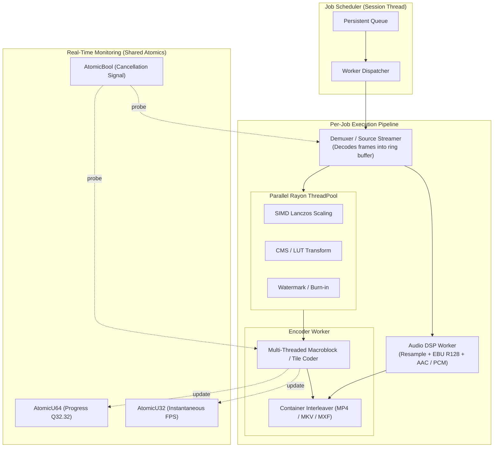

# encoderCraft Architecture & Engineering Specification

> **Target:** `encoderCraft` (`el-j/encodercraft` → `storytold/encodercraft`)  
> **Prepared for:** ArtCraft Ecosystem & Autonomous Agents  
> **Status:** Architecture Reference & Specification Document  
> **Enforcement:** Layering enforced by `cargo xtask layers`; Quality gates enforced by `cargo xtask ci`

---

## 1. Architectural Philosophy

`encoderCraft` is engineered as a clean-room, open-source, pure-Rust media encoding and queue processing system. It delivers professional parity with Adobe Media Encoder while extending capabilities to universal multi-media conversion (video, audio, raster, vector, 3D, and documents).

### Core Architectural Principles
1. **Never Crash:** Media files from the web or camera cards are untrusted, often corrupted, and potentially hostile. Every non-test crate denies all panics and unwraps:
   ```rust
   #![deny(
       clippy::unwrap_used,
       clippy::expect_used,
       clippy::panic,
       clippy::unimplemented,
       clippy::todo,
       clippy::unreachable
   )]
   ```
   No malformed frame header, truncated container, or unexpected sample rate may crash the application. Errors are cleanly surfaced as typed `Result<T, EncoderError>` values.
2. **Layered Decoupling:** Enforced via `cargo xtask layers`. Lower layers never depend on higher layers. The entire transcoding engine is 100% independent of any GUI library (egui, winit) and runs headlessly in CLI, daemon, and server environments.
3. **Pure-Rust First:** The workspace enforces `#![forbid(unsafe_code)]`. Hardware-accelerated encoders (Apple VideoToolbox, Windows Media Foundation, NVENC, Linux VAAPI) are quarantined inside a single isolated crate (`crates/platform`) with an explicit Architectural Decision Record (ADR 0001).
4. **Universal Media Processing:** A unified pipeline handles video, multi-channel audio, deep floating-point images, PBR texture maps, 3D meshes, and print documents.
5. **Autonomous & Scriptable:** Everything user-visible is an executable command in the engine command registry. First-class support for Unix domain sockets, Named Pipes, loopback JSON-RPC, and Model Context Protocol (MCP) allows AI agents and external apps to drive encoding without UI interaction.

---

## 2. Workspace Layering Model (L0 to L7)

The repository is structured as a Cargo workspace with distinct architectural layers:

```
┌──────────────────────────────────────────────────────────────────────────────────┐
│ L7: Applications                                                                 │
│     apps/encodercraft (GUI)   apps/encodercraft-cli   apps/encodercraft-daemon   │
├──────────────────────────────────────────────────────────────────────────────────┤
│ L6: Presentation & Agent Control                                                 │
│     crates/ui-egui (egui panels)         crates/mcp (Model Context Protocol)     │
├──────────────────────────────────────────────────────────────────────────────────┤
│ L5: Engine & Session Management                                                  │
│     crates/engine (Session, Command Registry, Job Queue, Journaling)             │
├──────────────────────────────────────────────────────────────────────────────────┤
│ L4: Pipeline & Automation                                                        │
│     crates/pipeline (Transcode Graph)    crates/watch (Folder Monitoring)        │
│     crates/ipc (Unix Sockets & RPC)      crates/presets (Preset Registry)        │
├──────────────────────────────────────────────────────────────────────────────────┤
│ L3: Encoders, Muxers & DSP Filters                                               │
│     crates/video-codecs                  crates/audio-dsp (EBU R128 Loudness)    │
│     crates/image-codecs                  crates/spatial-io (USD, glTF, FBX)      │
│     crates/platform (Hardware Enc)       crates/muxers (ISO BMFF, Matroska, MXF) │
├──────────────────────────────────────────────────────────────────────────────────┤
│ L2: Ingestion & Demuxers                                                         │
│     crates/demux (Parsers, Stream Extractors, Bitstream Probers)                 │
├──────────────────────────────────────────────────────────────────────────────────┤
│ L1: Core Data Models & Job Specifications                                        │
│     crates/core (JobSpec, Timecode, MediaDescriptor, FrameBuffers, Rational)     │
├──────────────────────────────────────────────────────────────────────────────────┤
│ L0: Foundational Primitives                                                      │
│     craft-libs/crates/media (craft-libs)  craft-libs/crates/cms (Color Profiles) │
│     crates/geom (Dimensions, Bounds)      crates/color (Pixel Formats, Matrix)   │
└──────────────────────────────────────────────────────────────────────────────────┘
```

### Detailed Layer Breakdown

| Layer | Crate Name | Directory | Primary Responsibilities |
|---|---|---|---|
| **L0** | `geom` | `crates/geom` | Dimensions, bounding boxes, pixel aspect ratios, scaling math, crop geometry. |
| **L0** | `color` | `crates/color` | Pixel format definitions (RGBA8, RGBA16, RGBAF32, YUV420p, YUV422p10, YUV444p12), matrix transforms (Rec.709, Rec.2020, Display P3), and `craft-cms` ICC integration. |
| **L1** | `core` | `crates/core` | Core domain models: `CraftJobSpec`, `OutputTarget`, `MediaTimecode`, `Rational64`, `AudioSampleBuffer`, `VideoFrame`, `MetadataSet`. |
| **L2** | `demux` | `crates/demux` | Container demuxing and format probing: ISO BMFF (MP4/MOV), Matroska (MKV/WebM), MXF, WAV/BWF, AIFF, OpenEXR, TIFF, PNG, glTF, USD. |
| **L3** | `video-codecs` | `crates/video-codecs` | Video encoders: Pure-Rust H.264, ProRes 422/4444, DNxHD/HR, APV, Motion-JPEG, animated GIF, and bridge to `effectcraft` HEVC/AV1/VP9. |
| **L3** | `audio-dsp` | `crates/audio-dsp` | Audio processing: Polyphase sample-rate resampler, channel mapping matrix, ITU-R BS.1770 / EBU R128 loudness normalization, True-Peak limiter. |
| **L3** | `image-codecs` | `crates/image-codecs` | Raster encoders: PNG, JPEG, WebP, AVIF, TIFF, OpenEXR (deep/layers), Radiance HDR, DDS (BC1–BC7), DPX. |
| **L3** | `spatial-io` | `crates/spatial-io` | 3D mesh exporters: USD/USDC/USDZ, glTF 2.0 / GLB, FBX, Wavefront OBJ, STL, PLY, and PBR channel packing (ORM, UDIM). |
| **L3** | `muxers` | `crates/muxers` | Muxer adapters for `craft-media` (ISO BMFF & Matroska) and `filmcraft-mxf`. |
| **L3** | `platform` | `crates/platform` | **Isolated `unsafe` crate (ADR 0001):** Hardware acceleration bridges for Apple VideoToolbox, Windows Media Foundation, NVENC, and Linux VAAPI. |
| **L4** | `pipeline` | `crates/pipeline` | Transcoding graph: connects demuxer → filters/scalers → encoder → muxer. Handles parallel frame pipelines with backpressure. |
| **L4** | `presets` | `crates/presets` | Preset manager: loads built-in factory presets, parses user JSON presets, evaluates dynamic "Match Source" rules. |
| **L4** | `watch` | `crates/watch` | Watch folder daemon: monitors directories, stabilizes incoming files, auto-dispatches jobs. |
| **L4** | `ipc` | `crates/ipc` | Inter-process communication: Unix domain socket, Windows named pipe, loopback JSON-RPC server (`127.0.0.1:8998`). |
| **L5** | `engine` | `crates/engine` | Central engine: `Session` state, queue management, job prioritization, command registry (`cmd/*`), persistent state journaling. |
| **L6** | `ui-egui` | `crates/ui-egui` | Desktop graphical interface: Queue table, Preset browser, Preview canvas, Inspector panels, theme tokens, localization. |
| **L6** | `mcp` | `crates/mcp` | Model Context Protocol server exposing encoding tools to AI agents. |
| **L7** | `encodercraft` | `apps/encodercraft` | Desktop application binary (eframe/wgpu runner). |
| **L7** | `encodercraft-cli` | `apps/encodercraft-cli` | Headless CLI binary: `encode`, `queue`, `watch`, `presets`, `mcp`, `daemon`. |
| **L7** | `encodercraft-daemon`| `apps/encodercraft-daemon`| Lightweight background service runner. |

---

## 3. Concurrency & Memory Architecture

High-throughput media encoding requires extreme parallel efficiency without lock contention or memory thrashing.



### 3.1 Bounded Ring Buffers & Backpressure
Decoding high-resolution 4K or 8K video frames into memory produces approximately **33 to 132 megabytes per frame** (in 10-bit RGBA). Allowing the demuxer to decode unrestricted ahead of the encoder would rapidly exhaust system RAM.

`encoderCraft` implements **bounded crossbeam-channel ring buffers**:
- Buffer depth is strictly capped (default: 8 frames, ~250 MB footprint).
- If the encoder lags behind (e.g. during heavy 2-pass AV1 encoding), the demuxer thread naturally blocks on the channel send.
- Zero unnecessary allocations: frame buffers are recycled through an object pool (`Arc<FrameBuffer>`), preventing memory fragmentation.

### 3.2 Lockless Progress & Safe Cancellation
- **Progress Reporting:** The encoding worker updates shared progress via `AtomicU64` storing a 32.32 fixed-point fraction ($0.0$ to $1.0$). The UI polling loop and IPC status prober read this atomic with `Ordering::Relaxed`, completely eliminating mutex contention.
- **Immediate Cancellation:** Every worker loop periodically probes an `Arc<AtomicBool>` cancel flag. When the user or IPC calls `queue.cancel`:
  1. The cancel flag is set to `true`.
  2. The demuxer immediately stops reading.
  3. The encoder discards pending buffers and exits.
  4. The job runner closes file handles and deletes partial temporary files.

### 3.3 Poison-Resilient Mutexes
Where shared state synchronization is unavoidable, locks are accessed through poison-recovery helpers:
```rust
pub fn lock_or_recover<T>(mutex: &Mutex<T>) -> Result<MutexGuard<'_, T>, LockError> {
    mutex.lock().or_else(|poison_err| {
        // Log poison occurrence and safely recover the inner state
        Ok(poison_err.into_inner())
    })
}
```

---

## 4. State Persistence & Crash Resilience

To guarantee that no user work, queued render, or watch-folder trigger is ever lost:

1. **Atomic State Journaling:** Every queue modification (job added, reordered, completed, paused) is written using an atomic write-replace pattern:
   - Serialize state to a temporary file (`queue-state.json.tmp`).
   - Flush and sync to disk (`std::fs::File::sync_all`).
   - Atomically rename over the active journal file (`std::fs::rename`).
2. **Crash Recovery on Startup:** Upon launch, `encoderCraft` inspects the journal:
   - Any job marked `Active` when the process terminated is flagged as `Interrupted`.
   - The user is offered an instant one-click option: **Resume Interrupted Jobs** or **Clean Temporary Files**.
3. **Escaped Panic Containment (`guard.rs`):**
   In the event of an unexpected panic in third-party parsing logic or FFI bridges, the job runner catches the panic boundary via `std::panic::catch_unwind`. The panic is converted into an `EncoderError::InternalPanic`, the specific job is marked `Failed` with diagnostic backtrace, and the queue worker smoothly continues processing the next job in line.

---

## 5. User Interface Architecture (`encoder-ui-egui`)

The graphical interface is built using `egui` and `eframe`, matching the dark-theme aesthetic of professional video editing tools:

```
┌────────────────────────────────────────────────────────────────────────────────────────┐
│ encoderCraft   [ File ]  [ Edit ]  [ Queue ]  [ Preset ]  [ Help ]        [ _ ] [ 口 ] [ X ] │
├────────────────────────────────────────────────────────────────────────────────────────┤
│ [▶ Start Queue] [⏸ Pause] [⏹ Stop]   │ Search Presets: [🔍                 ]             │
├──────────────────────────────────────┼─────────────────────────────────────────────────┤
│ Queue (3 items)                      │ Preset Browser                                  │
│ ┌──────────────────────────────────┐ │ 📁 Match Source                                 │
│ │▼ Master_Cut_01.mov               │ │   ⚡ Match Source - Adaptive High Bitrate       │
│ │  ├─ 🌐 YouTube 4K UHD (Queued)   │ │ 📁 Web & Social Media                         │
│ │  └─ 📺 Apple ProRes 422 (Done)   │ │   🌐 YouTube (4K, 1440p, 1080p, Shorts)         │
│ │▶ Podcast_Episode_42.wav          │ │   🌐 TikTok / Instagram Reels                   │
│ │  └─ 🎵 Streaming MP3 160k (Ready)│ │ 📁 Broadcast & Master Archival                  │
│ │▶ Hero_Character_Rig.fbx          │ │   📺 Apple ProRes (4444 XQ, 4444, 422 HQ)       │
│ │  ├─ 🧊 Web 3D (.glb Draco) (Done)│ │   📺 Avid DNxHR (HQX, SQ)                       │
│ │  └─ 🧊 Apple AR QuickLook (.usdz)│ │ 📁 Audio & Music Mastering                      │
│ └──────────────────────────────────┘ │   🎵 Master Delivery (BWF 96k/24b)              │
├──────────────────────────────────────┴─────────────────────────────────────────────────┤
│ Active Job: Master_Cut_01.mov ➔ YouTube 4K UHD                                         │
│ [██████████████████████████████░░░░░░░░░░░░░░░] 68.4% (Pass 1/1)                       │
│ 142.8 FPS · Elapsed: 00:01:24 · Remaining: 00:00:38 · Bitrate: 44.2 Mbps · Rec.709    │
├──────────────────────────────────────┬─────────────────────────────────────────────────┤
│ Video Preview                        │ Output Details                                  │
│ ┌──────────────────────────────────┐ │ Destination: /Volumes/Media/Exports/Cut_4K.mp4 │
│ │                                  │ │ Format: H.264 (Main 10) / MP4                   │
│ │         [Frame Display]          │ │ Dimensions: 3840 x 2160 (Match Source)          │
│ │                                  │ │ Audio: AAC Stereo 320 kbps (EBU R128 -14 LUFS)  │
│ └──────────────────────────────────┘ │ Status: Encoding frame 4,102 of 6,000           │
└────────────────────────────────────────────────────────────────────────────────────────┘
```

### UI Features & Design Constraints
- **Zero Lock-up:** The UI never performs file I/O or transcoding calculations on the main thread. All state updates are received via non-blocking channels.
- **Theme Tokens:** Visual styling uses centralized design tokens (`theme::Tokens`), ensuring consistent spacing, contrast ratios, and iconography across all ArtCraft applications.
- **Display Scaling & HiDPI:** Fully responsive vector UI that renders sharply on Apple Retina displays and 4K Windows/Linux monitors.
- **Internationalization (`craft-i18n`):** All UI strings, menu labels, preset descriptions, and tooltips are cataloged for multi-language localization.

---

## 6. Testing & Verification Architecture

To enforce the "never crash" standard, `encoderCraft` employs a rigorous four-layer testing matrix:

1. **Unit Tests:** Embedded across every crate testing individual functions (rational arithmetic, timecode conversions, color matrix transforms, box parsers).
2. **Property-Based Testing (`proptest`):** Fuzzes parsers with randomized, malformed, and truncated bitstreams to prove that no input sequence can trigger an unwrap or panic.
3. **Reference Comparison Tests (Oracles):** Tests decode and encode outputs against standard reference binaries (`ffmpeg` and `ffprobe` detected on `PATH`) verifying bitstream validity, packet timestamps, duration, and color metadata.
4. **Integration & Parity Scenarios (`cargo xtask test`):** Executes full end-to-end transcode pipelines verifying round-trip fidelity across video, audio, image, and 3D conversions.
