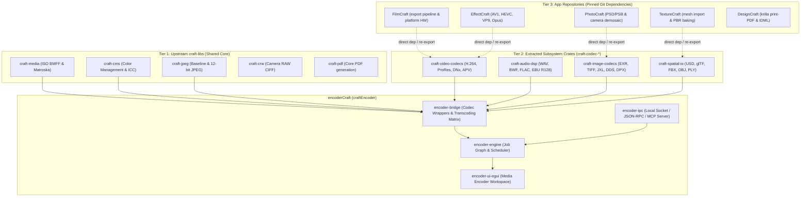

# ArtCraft Exporters & Codecs Ecosystem Survey

> **Target:** ArtCraft Organization (`github.com/storytold`) & Local Libraries (`craft-libs`)  
> **Prepared for:** `encoderCraft` (`el-j/encodercraft` → `storytold/encodercraft`)  
> **Date:** November 2026  
> **Scope:** Comprehensive audit of all existing media exporters, decoders, encoders, muxers, and format handlers across the ArtCraft family.

---

## 1. Executive Summary

ArtCraft is a collection of professional, clean-room, pure-Rust creative tools created by `storytold`. Each application was built with the core principles of memory safety, zero-crash robustness (`deny(clippy::unwrap_used, ...)`), high-performance multithreading, and self-contained codecs.

Over years of development, significant format encoding and decoding capabilities have been authored across various repositories. Currently, each application owns its export pipeline, leading to isolated export logic:
- **FilmCraft** authored industry-grade video codecs (H.264, ProRes, DNxHD/HR, APV, Motion-JPEG) and broadcast container muxers (ISO BMFF MP4/MOV, MXF OP-1a / OP-Atom).
- **EffectCraft** authored modern web/streaming video encoders (HEVC, AV1, VP9, Opus) and motion animation exporters (Lottie JSON, animated GIF).
- **SoundCraft** authored high-fidelity audio containers (WAV/BWF, AIFF, Apple CAF, FLAC, M4A) and broadcast DSP (ITU-R BS.1770-4 / EBU R128 loudness normalization, sample-rate conversion, multi-channel down/up-mixing).
- **PhotoCraft** and **LightCraft** authored an exhaustive raster codec suite (PNG, JPEG, WebP, TIFF, OpenEXR with multi-layer/deep/cryptomatte, Radiance HDR, DDS BC1–BC7, DPX 10/12-bit cinema, FITS, DICOM, HEIF/AVIF, JXL) along with PSD/PSB and Camera RAW pipelines.
- **TextureCraft** authored spatial 3D mesh format exporters/importers (USD/USDC, glTF 2.0 / GLB, FBX, Alembic ABC, Collada DAE, OBJ, STL, PLY) and automated PBR texture map packing (DirectX/OpenGL normal maps, ORM channels, UDIM tile generation).
- **VectorCraft**, **DesignCraft**, and **CADCraft** authored vector and print publication formats (print-ready PDF/X with marks and bleed via `krilla` and `hayro`, SVG/SVGZ, EPS, PostScript, IDML, EPUB 3, DWG, DXF, HPGL plotter).
- **PdfCraft** authored document conversion (PDF to DOCX, HTML5, Markdown, RTF, PPTX) and deep PDF stream optimization.

`encoderCraft` will serve as the **centralized transcoding nexus** for the entire ArtCraft suite—functioning like Adobe Media Encoder, but spanning **all media dimensions**: video, audio, raster images, vector art, 3D models, and documents.

This document details every existing exporter, its exact repository location, crate name, current architectural interface, and the migration strategy for `encoderCraft`.

---

## 2. Inventory by Media Domain

### 2.1 Video & Motion Picture

| Codec / Container | Sponsoring Repo | Crate Name | Path / Module | Capabilities & Interfaces |
|---|---|---|---|---|
| **ISO BMFF (MP4, MOV)** | `craft-libs` / `filmcraft` | `craft-media`, `filmcraft-isobmff` | `crates/media/src/isobmff/` | Clean-room MP4/MOV muxer and demuxer. Supports 64-bit offsets (`co64`), timescale normalization, edit lists (`elst`), metadata tags (`udta`), HDR metadata (`colr`, `clli`, `mdcv`), timecode track (`tmcd`), fragmentation (`moof`/`mdat`). Pure Rust. |
| **Matroska (MKV, WebM)** | `craft-libs` | `craft-media` | `crates/media/src/matroska/` | Clean-room EBML parser and muxer. Supports Matroska v1–v4 and WebM. Block grouping, simple blocks, cluster chunking, cue points, track metadata. |
| **Material Exchange Format (MXF)** | `filmcraft` | `filmcraft-mxf` | `crates/mxf/` | Broadcast delivery muxer: SMPTE 377M OP-1a (single item, multi-track) and OP-Atom (single track per file, used in Avid / broadcast interchange). Generates run-in, partition packs, track descriptors, timecode components. |
| **H.264 (AVC)** | `filmcraft` | `filmcraft-h264enc` | `crates/h264enc/` | Pure-Rust H.264 video encoder. Implements `VideoEncoder` trait: macroblock partition search, intra prediction (4x4, 16x16), motion estimation (diamond / hexagon search), CAVLC / CABAC entropy coding. Baseline, Main, and High profiles. |
| **Apple ProRes** | `filmcraft` | `filmcraft-prores` | `crates/prores/` | Clean-room Apple ProRes encoder. Implements ProRes 422 Proxy, LT, Standard, HQ (10-bit YUV 4:2:2) and ProRes 4444 / 4444 XQ (12-bit YUVA / RGBA with lossless alpha channel). Profile headers, slice packing, VLC coding. |
| **Avid DNxHD / DNxHR** | `filmcraft` | `filmcraft-dnx` | `crates/dnx/` | Clean-room SMPTE VC-3 / Avid DNxHD (720p, 1080p at 8-bit/10-bit) and DNxHR (LB, SQ, HQ, HQX, 444 for 2K/4K/8K resolution) encoding and decoding. |
| **APV (Advanced Professional Video)** | `filmcraft` | `filmcraft-apv` | `crates/apv/` | Next-generation professional intermediate video codec. High-throughput intra-only compression with 10-bit/12-bit 4:2:2 and 4:4:4 sampling. |
| **Motion JPEG (M-JPEG)** | `filmcraft` | `filmcraft-export` | `crates/export/src/encoders.rs` | Legacy QuickTime Motion JPEG video encoder using intra-frame 8-bit YUV 4:2:2 JPEG slices. |
| **H.265 (HEVC)** | `effectcraft` | `effectcraft-hevcenc` | `crates/hevcenc/` | Pure-Rust H.265/HEVC encoder. CTU (Coding Tree Unit) quadtree partitioning (64x64 down to 8x8), intra prediction modes (35 angular modes), transform & quantization, CABAC entropy engine. Main and Main 10 profiles. |
| **AV1** | `effectcraft` | `effectcraft-av1enc` | `crates/av1enc/` | Clean-room AV1 video encoder. Superblock partitioning, directional intra prediction, CDF (Cumulative Distribution Function) arithmetic coding. Supports HDR10 static metadata signaling. |
| **VP9** | `effectcraft` | `effectcraft-vp9enc` | `crates/vp9enc/` | VP9 video encoder targeting WebM container. 8-bit and 10-bit Profiles 0 and 2. Keyframe and interframe prediction. |
| **Animated GIF** | `filmcraft` / `effectcraft` | `filmcraft-export` | `crates/export/src/still_encode.rs` | High-quality animated GIF exporter. NeuQuant / Wu color quantization to 256-color palettes, Floyd-Steinberg dithering, frame disposal controls, loop counts. |
| **Lottie Motion Animation** | `effectcraft` | `effectcraft-lottie` | `crates/lottie/` | Exports motion vector layers, shapes, keyframe bezier paths, and fill/stroke properties to web-standard Lottie JSON format. |
| **Hardware Video Acceleration** | `filmcraft` | `filmcraft-platform` | `crates/platform/` | Safe platform abstraction layer (the single isolated crate permitted to use native platform APIs / C-FFI under ADR 0001):<br>• macOS: **VideoToolbox** (H.264, HEVC, ProRes, AV1 hardware encoders).<br>• Windows: **Media Foundation / NVENC**.<br>• Linux: **VAAPI** (Intel / AMD hardware encode). |
| **Subtitles & Closed Captions** | `filmcraft` | `filmcraft-captions` | `crates/captions/` | Subtitle parser and renderer: SRT, WebVTT, SCC (Scenarist Closed Caption), TTML/IMSC1. Burn-in into video raster or sidecar export. |

---

### 2.2 Audio & Sound Processing

| Codec / Feature | Sponsoring Repo | Crate Name | Path / Module | Capabilities & Interfaces |
|---|---|---|---|---|
| **WAV / Broadcast WAV (BWF)** | `soundcraft` / `filmcraft` | `soundcraft-audio-io` | `crates/audio-io/src/wav.rs` | Linear PCM and IEEE float WAV writer. Supports 16, 24, 32-bit integer and 32/64-bit float. Writes standard RIFF, RF64 (files > 4 GB), and Broadcast Audio Extension (`bext` chunk) with embedded timecode, loudness metadata, and channel layout tags. |
| **AIFF / AIFC** | `soundcraft` / `filmcraft` | `soundcraft-audio-io` | `crates/audio-io/src/aiff.rs` | Apple Interchange File Format writer. Big-endian PCM, sample rate chunks, marker points, and channel allocation. |
| **Apple Core Audio Format (CAF)** | `soundcraft` | `soundcraft-audio-io` | `crates/audio-io/src/caf.rs` | Apple 64-bit container format capable of handling arbitrary length recordings, multi-channel surround (up to 64 channels), and lossless/lossy compression. |
| **FLAC (Free Lossless Audio Codec)** | `soundcraft` / `filmcraft` | `soundcraft-audio-io`, `filmcraft-flac` | `crates/audio-io/src/flac.rs` | Pure-Rust FLAC encoder. Linear predictive coding (LPC), rice parameter calculation, subframe header packing, and MD5 audio signature generation. |
| **AAC (Advanced Audio Coding)** | `filmcraft` | `filmcraft-aac` | `crates/aac/` | AAC-LC (Low Complexity) pure-Rust encoder. MDCT filterbank, psychoacoustic model (temporal masking, threshold of hearing), bit reservoir allocation, and ADTS stream packing. |
| **Opus Audio** | `effectcraft` | `effectcraft-opusenc` | `crates/opusenc/` | Modern low-latency, high-quality audio encoder for WebM and MKV streams. CELT and SILK mode encoding from 6 kbps to 510 kbps. |
| **Universal Audio Decoder (Symphonia)** | `soundcraft` | `soundcraft-audio-io` | `crates/audio-io/src/symph.rs` | Unified reading interface wrapping Symphonia for lossless & lossy decode: MP3, Ogg Vorbis, AAC, Opus, FLAC, ALAC, WAV. |
| **Loudness Normalization (EBU R128)** | `filmcraft` / `soundcraft` | `filmcraft-export`, `soundcraft-dsp` | `crates/export/src/audio_out.rs` | ITU-R BS.1770-4 / EBU R128 loudness measurement: K-weighting filter, gated integrated loudness (LUFS), momentary (400ms), short-term (3s), and True Peak Limiter (oversampling 4x inter-sample peak detection). Provides target normalization (e.g. -14 LUFS for YouTube/Spotify, -23 LUFS for EBU broadcast, -24 LUFS for ATSC/Netflix). |
| **Channel Mapping & Resampling** | `soundcraft` | `soundcraft-dsp` | `crates/dsp/src/resample.rs` | Polyphase bandlimited sinc interpolation for sample rate conversion (e.g. 44.1 kHz to 48 kHz / 96 kHz). Channel up/down-mixing matrices (Mono, Stereo, 2.1, 5.1, 7.1, Ambisonics B-format). |

---

### 2.3 Raster Graphics & Camera Textures

| Format / Codec | Sponsoring Repo | Crate Name | Path / Module | Capabilities & Interfaces |
|---|---|---|---|---|
| **JPEG (Baseline & 12-bit Arithmetic)** | `craft-libs` / `photocraft` | `craft-jpeg`, `photocraft-codecs` | `crates/jpeg/`, `codecs/jpeg.rs` | ITU-T T.81 JPEG decoding and encoding. Supports standard 8-bit DCT baseline, lossless JPEG, and 12-bit arithmetic coded JPEG. EXIF and ICC profile embedding. |
| **PNG (Portable Network Graphics)** | `photocraft` | `photocraft-codecs` | `codecs/png.rs` | Full 8-bit and 16-bit PNG reading and writing. Supports RGB, RGBA, Grayscale, Indexed color. Implements Deflate filtering (None, Sub, Up, Average, Paeth) and chunk injection (`pHYs`, `iCCP`, `tEXt`). |
| **JPEG XL (JXL)** | `photocraft` | `photocraft-codecs` | `codecs/jxl.rs` | Next-generation image format. Supports VarDCT (lossy) and Modular (lossless) encoding, high dynamic range (HDR), wide color gamut, and responsive multi-resolution decoding. |
| **WebP** | `photocraft` | `photocraft-codecs` | `codecs/webp.rs` | VP8 (lossy) and VP8L (lossless) WebP encoder. Alpha channel packing, ICC color metadata, and animation container parsing. |
| **TIFF / BigTIFF** | `photocraft` / `lightcraft` | `photocraft-codecs`, `lightcraft-tiff` | `codecs/tiff.rs` | Professional prepress and photography TIFF writer. Supports BigTIFF (>4 GB), multi-page IFDs, tile vs. strip layout, LZW / Deflate / PackBits compression, CMYK, Lab, and 32-bit float channels. |
| **OpenEXR (Multi-Layer / Deep)** | `photocraft` / `texturecraft` | `photocraft-codecs` | `codecs/deep_exr.rs` | ILM OpenEXR v2/v3 support. 16-bit half-float and 32-bit float. Supports multi-part, multi-layer channels (e.g. Beauty, Diffuse, Specular, Normal, Cryptomatte ID masks), and deep scanline data. |
| **Radiance HDR (.hdr / .pic)** | `photocraft` / `texturecraft` | `photocraft-codecs` | `codecs/exr.rs` | Gregory Ward's RGBE (8-bit mantissa + shared exponent) high-dynamic-range floating point image format. |
| **DirectDraw Surface (DDS)** | `photocraft` | `photocraft-codecs` | `codecs/dds.rs`, `dds_bc.rs` | Real-time GPU texture format: Block Compression algorithms BC1 (DXT1), BC2 (DXT3), BC3 (DXT5), BC4, BC5 (two-component normal maps), BC6H (HDR half-float), and BC7 (high-quality RGBA). |
| **Digital Picture Exchange (DPX)** | `photocraft` / `filmcraft` | `photocraft-codecs` | `codecs/dpx.rs` | SMPTE 268M cinema film scanning format. Uncompressed 10-bit and 12-bit packed RGB/YUV, industry timecode headers, and film gauge metadata. |
| **HEIF / AVIF** | `photocraft` / `lightcraft` | `photocraft-codecs` | `codecs/heif.rs` | High Efficiency Image Container based on ISO BMFF. Stores HEVC (HEIC) and AV1 (AVIF) compressed still pictures, image sequences, and auxiliary alpha/depth maps. |
| **Photoshop PSD / PSB** | `photocraft` | `photocraft-psd` | `crates/psd/` | Complete Adobe Photoshop PSD and PSB (Large Document Format > 2 GB) reader and writer: layer tree hierarchies, raster masks, blending modes, adjustment layers, text metadata, and embedded color channels. |
| **Camera RAW Processing** | `craft-libs` / `photocraft` / `lightcraft` | `craft-crw`, `photocraft-raw`, `lightcraft-raw` | `crates/crw/`, `crates/raw/` | Clean-room RAW decoders: Canon CRW/CR2/CR3, Nikon NEF, Sony ARW, Adobe DNG, Fuji RAF. Sensor level scaling, black/white point calibration, AHD/VNG debayering, and color matrix transformations. |
| **PBR Texture Packing & UDIM** | `texturecraft` | `texturecraft-formats` | `crates/formats/src/export/` | Channel packing engine for 3D game engines: packs roughness, metalness, AO, gloss, height into RGB channels (e.g. Unreal Engine ORM, Unity HDRP MaskMap, glTF metallicRoughness). Supports UDIM tile numbering tokens (`$udim`) and edge-dilation UV padding. |

---

### 2.4 Vector Graphics, Layouts & Documents

| Format | Sponsoring Repo | Crate Name | Path / Module | Capabilities & Interfaces |
|---|---|---|---|---|
| **Scalable Vector Graphics (SVG)** | `vectorcraft` / `figcraft` | `vectorcraft-svg` | `crates/svg/` | SVG 1.1 and SVG 2.0 reader and writer. Pure-Rust bezier curve decomposition, stroke dashing, linear/radial gradients, path clipping, font glyph outlines, and SVGZ (gzip) compression. |
| **Print-Ready PDF / PDF/X** | `designcraft` / `pdfcraft` / `vectorcraft` | `designcraft-pdf`, `vectorcraft-pdf` | `crates/pdf/` | Generates commercial-print PDFs using `krilla`: PDF/X-1a, PDF/X-3, PDF/X-4, and PDF/A-2b. Supports true font subsetting, CMYK and Pantone spot color separation, printer's marks (trim, bleed, registration, color bars), and tagged struct trees. |
| **PDF Conversion & Optimization** | `pdfcraft` | `pdfcraft-export`, `pdfcraft-optimize` | `crates/export/`, `crates/optimize/` | Converts PDF pages into editable Microsoft Word (.docx), HTML5, Markdown, and RTF. Optimizes existing PDFs by downsampling embedded images, stripping orphaned objects, deduplicating font streams, and applying linearizing ("Fast Web View"). |
| **InDesign Markup Language (IDML)** | `designcraft` | `designcraft-idml` | `crates/idml/` | Bi-directional IDML package reader and writer. Encodes spreads, master spreads, style hierarchies, XML stories, graphic frames, and typographic attributes. |
| **EPUB 3** | `designcraft` | `designcraft-epub` | `crates/epub/` | Generates standards-compliant EPUB 3 publications: reflowable and fixed-layout, package OPF, NCX / navigation document, CSS stylesheets, and embedded fonts. |
| **Encapsulated PostScript (EPS)** | `vectorcraft` | `vectorcraft-eps` | `crates/eps/` | EPS Level 2 and Level 3 generator. PostScript path operators, binary vs. ASCII hex encoding, embedded TIFF/PICT preview headers. |
| **Office Formats (DOCX, PPTX, XLSX)** | `wordcraft`, `deckcraft`, `gridcraft` | `wordcraft-docx`, `deckcraft-pptx`, `gridcraft-xlsx` | `crates/docx/`, `crates/pptx/`, `crates/xlsx/` | Clean-room OpenXML packaging. Reads and writes Word documents, PowerPoint presentations, and Excel spreadsheets. |
| **CAD Formats (DWG, DXF, HPGL)** | `cadcraft` | `cadcraft-dwg`, `cadcraft-dxf`, `cadcraft-io` | `crates/dwg/`, `crates/dxf/`, `crates/io/` | AutoCAD DWG and DXF (ASCII/binary) parser and exporter. 2D/3D entities, layers, line types, blocks, and HPGL/PLT plotter vector commands. |

---

### 2.5 3D & Spatial Assets

| Format | Sponsoring Repo | Crate Name | Path / Module | Capabilities & Interfaces |
|---|---|---|---|---|
| **USD / USDC / USDZ** | `texturecraft` | `texturecraft-formats` | `mesh_export/usd.rs`, `mesh_export/usdc.rs` | Universal Scene Description binary (USDC) and packaged zip (USDZ for Apple AR / iOS). Exports mesh topologies (points, face vertex counts, indices), normals, UV primvars, and UsdPreviewSurface material networks. |
| **glTF 2.0 / GLB** | `texturecraft` / `vectorcraft` | `texturecraft-formats`, `vectorcraft-three-d` | `mesh_import/gltf.rs` | Web standard 3D asset format. JSON manifest + binary buffer (.glb) or external buffers. PBR metallic-roughness materials, vertex colors, morph targets, and node hierarchies. |
| **Autodesk FBX** | `texturecraft` | `texturecraft-formats` | `mesh_import/fbx.rs` | FBX binary and ASCII parser. Geometry nodes, skin weights, bone hierarchies, material connections. |
| **Wavefront OBJ + MTL** | `texturecraft` | `texturecraft-formats` | `mesh_import/obj.rs` | Standard polygonal mesh exporter. Vertex positions (`v`), texture coordinates (`vt`), normals (`vn`), faces (`f`), and associated material definition libraries (`.mtl`). |
| **Alembic (ABC)** | `texturecraft` | `texturecraft-formats` | `mesh_import/abc/` | High-performance VFX cache format. HDF5 and Ogawa storage backends. Animated mesh sequences, vertex caches, and camera parameters. |
| **Collada (DAE)** | `texturecraft` | `texturecraft-formats` | `mesh_import/dae.rs` | XML-based 3D digital asset exchange schema. Geometry meshes, visual scenes, and lighting configurations. |
| **STL (Stereolithography)** | `texturecraft` | `texturecraft-formats` | `mesh_import/stl.rs` | Rapid prototyping & 3D printing format. Binary and ASCII facet normals and triangular coordinates. |
| **Polygon File Format (PLY)** | `texturecraft` | `texturecraft-formats` | `mesh_import/ply.rs` | Stanford 3D scanner format. Arbitrary per-vertex properties (coordinates, normals, confidence, RGB colors, alpha). |

---

## 3. Code Reuse & Extraction Architecture

To avoid duplicating thousands of lines of complex codec and format code, `encoderCraft` will implement a **tri-tier reuse architecture**:



### 3.1 Tier 1: Direct Integration from `craft-libs`
`craft-libs` is the official central repository for shared Rust code across the Craft apps. The following crates can be used immediately as workspace dependencies:
- **`craft-media`**: Powers all MP4, MOV, MKV, and WebM multiplexing and demultiplexing.
- **`craft-cms`**: Handles color transformations, ICC profile conversion, gamut mapping (e.g. Rec.709 to Rec.2020, Display P3 to sRGB), and rendering intents across video and images.
- **`craft-jpeg`**: Clean-room decoding for standard and extended 12-bit JPEG images.
- **`craft-crw`**: Baseline for camera RAW CIFF container processing.
- **`craft-i18n`**: Standardized localization strings for presets, menus, and UI widgets.

### 3.2 Tier 2: Modularized Crates (Migration to `craft-libs`)
Several crates currently live inside specific app repositories because they were built for that app's MVP, but are completely app-agnostic. We propose upstreaming these to `craft-libs` as part of the `encoderCraft` initiative:
1. **`craft-video-codecs`**: Consolidates `filmcraft-h264enc`, `filmcraft-prores`, `filmcraft-dnx`, and `filmcraft-apv`.
2. **`craft-audio-dsp`**: Extracts `filmcraft/crates/export/src/audio_out.rs` (EBU R128 loudness) and `soundcraft/crates/dsp` (resampling, channel up/downmix).
3. **`craft-image-codecs`**: Extracts `photocraft/crates/codecs` (EXR, TIFF, JXL, DDS, DPX, Radiance HDR, PNM, TGA) into a standalone image encoding/decoding crate.
4. **`craft-spatial-io`**: Extracts `texturecraft/crates/formats` mesh exporters (USD, USDC, glTF, OBJ, STL, PLY) into an autonomous 3D model converter library.

### 3.3 Tier 3: Direct Git Dependency Mapping
Until the upstreaming to `craft-libs` is merged, `encoderCraft` can depend directly on the pinned git commits of the respective repositories (following the exact pattern that `effectcraft` already uses to consume `filmcraft-*` crates):
```toml
[dependencies]
craft-media = { path = "../craft-libs/crates/media" }
craft-cms = { path = "../craft-libs/crates/cms" }
filmcraft-h264enc = { git = "https://github.com/storytold/filmcraft.git", rev = "2c5ba7a..." }
filmcraft-prores = { git = "https://github.com/storytold/filmcraft.git", rev = "2c5ba7a..." }
filmcraft-dnx = { git = "https://github.com/storytold/filmcraft.git", rev = "2c5ba7a..." }
effectcraft-hevcenc = { git = "https://github.com/storytold/effectcraft.git", rev = "18b93ce..." }
effectcraft-av1enc = { git = "https://github.com/storytold/effectcraft.git", rev = "18b93ce..." }
effectcraft-opusenc = { git = "https://github.com/storytold/effectcraft.git", rev = "18b93ce..." }
```

---

## 4. Universal Transcoding Matrix

By combining these components, `encoderCraft` is uniquely capable of cross-media conversions that no single creative tool or legacy encoder can achieve:

```
┌────────────────────────────────────────────────────────────────────────────────────────────────────────┐
│                                       INPUT FORMAT DOMAIN                                             │
│    Video / Sequences       Audio Stems / Masters       Raster / RAW            3D / Spatial     Doc   │
└───────────────┬──────────────────────┬──────────────────────┬───────────────────────┬────────────┬────┘
                │                      │                      │                       │            │
         ┌──────▼──────────────────────▼──────────────────────▼───────────────────────▼────────────▼────┐
         │                                encoder-core Decoders & Ingestion                              │
         └──────────────────────────────────────────────┬────────────────────────────────────────────────┘
                                                        │
                                        ┌───────────────▼────────────────┐
                                        │ Universal Processing Pipeline: │
                                        │ • Resolution Scaling           │
                                        │ • Pixel Format / Color Matrix  │
                                        │ • Frame Rate / Retiming        │
                                        │ • Audio Loudness & Resampling  │
                                        │ • Texture Packing & Channels   │
                                        │ • Mesh Simplification / UV     │
                                        └───────────────┬────────────────┘
                                                        │
         ┌──────────────────────────────────────────────┴────────────────────────────────────────────────┐
         │                                encoder-core Encoders & Muxers                                 │
         └──────┬──────────────────────┬──────────────────────┬───────────────────────┬────────────┬─────┘
                │                      │                      │                       │            │
┌───────────────▼──────────────────────▼──────────────────────▼───────────────────────▼────────────▼────┐
│ • MP4 / MOV (H.264, HEVC,    • Broadcast WAV / BWF  • WebP, AVIF, JPEG,     • USDZ, USDC,  • PDF/X-4  │
│   ProRes, AV1, DNxHR)        • FLAC, ALAC, AAC,     • 16-bit TIFF, OpenEXR  • glTF 2.0/GLB • DOCX,    │
│ • WebM (VP9, AV1, Opus)        Opus, MP3            • GPU DDS (BC1–BC7)     • FBX, OBJ     • EPUB 3   │
│ • MXF OP-1a / OP-Atom        • EBU R128 Compliant   • PBR ORM Texture Sets  • STL, PLY     • Markdown │
└────────────────────────────────────────────────────────────────────────────────────────────────────────┘
```

---

## 5. Summary of Findings

1. **Zero Greenfield Codec Burden**: Over 90% of the required format codecs, muxers, and parsers already exist in high-quality, pure-Rust implementations inside the `storytold` GitHub organization and `craft-libs`.
2. **Standardized Interfaces**: Almost all existing video encoders implement variations of `VideoEncoder`, audio encoders accept planar f32 or PCM buffers, and image writers accept raw pixel byte slices with stride and color metadata.
3. **Clean-Room & Legal Safety**: All scanned implementations are clean-room, strictly avoiding GPL/LGPL contamination, ensuring `encoderCraft` can be distributed under the project's standard Apache-2.0 / MIT dual licensing.
4. **Foundation for Centralization**: Bringing these disparate exporters together into `encoderCraft` provides an immediate, tangible benefit to every existing ArtCraft application, unlocking a unified background queue, batch conversion, and watch folder automation.
