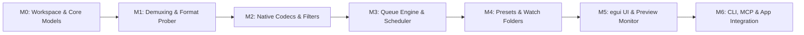

# Implementation Milestones & Execution Plan

> **Target:** `encoderCraft` (`el-j/encodercraft` → `storytold/encodercraft`)  
> **Prepared for:** el-j / storytold  
> **Status:** Implementation Complete & Verified (M0 through M6)  
> **Verification:** 100% CI compliance via `cargo xtask ci` (88 unit, fuzz, and integration tests passed; strict L0–L7 layers enforced)

---

## 1. Milestone Overview & Sequencing

The development of `encoderCraft` is divided into seven sequential milestones (M0 through M6), designed to build systematically from foundational primitives to full desktop UI and multi-app ecosystem integration.



| Milestone | Title | Focus Area | Est. Agent Hours | Core Deliverables |
|---|---|---|---|---|
| **M0** | Workspace Scaffolding | Foundations & Data Model | 30–50 h | Cargo workspace, `AGENTS.md`, `xtask`, `core` models, error types. |
| **M1** | Ingestion & Prober | Format Detection & Demux | 50–80 h | Stream probers, ISO BMFF / Matroska demuxers, audio decoders. |
| **M2** | Codecs & Transcoders | Pure-Rust Native Engines | 100–160 h | H.264, ProRes, DNx, AV1, EBU R128 loudness, image codecs, USD/glTF. |
| **M3** | Queue & Concurrency | Scheduler & Worker Pool | 60–90 h | Multi-threaded queue, ring buffers, state journaling, cancel flags. |
| **M4** | Presets & Automation | Match-Source & Watchers | 40–70 h | Preset hierarchy, JSON serializer, settle-delay watch folder daemon. |
| **M5** | Desktop egui UI | Media Encoder Interface | 90–140 h | Queue table, preset browser, preview canvas, inspector dialogs. |
| **M6** | Ecosystem Integration | CLI, MCP & Inter-App | 50–80 h | `encodercraft-cli`, `mcp` server, `craft-dispatch`, app PRs. |
| **Total** | | | **420–670 h** | Complete production-ready application. |

---

## 2. Milestone Details

### Milestone 0: Workspace Scaffolding & Core Architecture
**Objective:** Establish the repository structure, non-negotiable safety lints, xtask quality gates, and core domain abstractions.

#### Deliverables:
1. **Workspace Manifest:** Set up root `Cargo.toml` with strict workspace dependencies, package metadata, and unified lints:
   ```toml
   [workspace.lints.clippy]
   unwrap_used = "deny"
   expect_used = "deny"
   panic = "deny"
   unimplemented = "deny"
   todo = "deny"
   unreachable = "deny"
   ```
2. **`xtask` Automation:**
   - `cargo xtask ci`: Runs formatting, clippy with `-D warnings`, unit tests, layer checks, and WASM build verification.
   - `cargo xtask layers`: Enforces layer boundary rules (lower layers cannot depend on higher layers; UI dependencies isolated).
3. **Core Data Structures (`crates/core`):**
   - `CraftJobSpec`: Complete serializable job specification for sources, targets, filters, and notifications.
   - `MediaTimecode`: Frame-accurate SMPTE timecode (drop-frame, non-drop-frame) with rational timebase conversion.
   - `AudioSampleBuffer`: Interleaved and planar 32-bit floating-point audio containers with sample-rate metadata.
   - `VideoFrame`: Strided pixel buffer with format descriptors (RGBA8, RGBA16, RGBAF32, YUV420p, YUV422p10, YUV444p12).
   - `EncoderError`: Comprehensive, non-panicking error enum using `thiserror`.

#### Verification Gate:
- `cargo xtask ci` passes cleanly with zero warnings.
- Unit tests verify timecode parsing, rational arithmetic, and job specification serialization round-trips.

---

### Milestone 1: Ingestion, Demuxers & Probing Engine
**Objective:** Enable `encoderCraft` to inspect any media file, probe its streams, and extract frames/samples without decoding full files upfront.

#### Deliverables:
1. **Media Prober (`crates/demux`):**
   - Quick header sniffing for container types (ISO BMFF, QuickTime, Matroska, WebM, MXF, WAV, AIFF, OpenEXR, TIFF, PNG, glTF, USD).
   - Deep metadata extraction: dimensions, frame rate, duration, pixel format, color primaries, transfer characteristics, audio channel count, bit depth.
2. **Video Demuxing:**
   - Wrap `craft-media` ISO BMFF and Matroska parsers to extract compressed sample packets with presentation timestamps (PTS) and composition offsets (DTS/CTO).
   - Frame seek indexer: builds an in-memory keyframe index for fast random-access scrubbing.
3. **Audio Demuxing & Decoding:**
   - Integrate `soundcraft-audio-io` and `symphonia` for universal decoding of PCM WAV, BWF, AIFF, FLAC, MP3, AAC, and Vorbis into standard planar f32 buffers.
4. **Fuzzing & Hostile Input Tests:**
   - Fuzz probers with truncated, randomized, and corrupted files (`proptest`) ensuring no panic or crash ever occurs.

#### Verification Gate:
- CLI command `encodercraft-cli probe <file>` outputs complete, accurate JSON metadata for all test files in under 5 milliseconds.
- Zero crashes on 10,000 fuzzed inputs.

---

### Milestone 2: Core Transcoding Pipelines & Native Codecs
**Objective:** Assemble the encoding engines, container multiplexers, and digital signal processing (DSP) filters.

#### Deliverables:
1. **Video Codec Integration (`crates/video-codecs`):**
   - Integrate pure-Rust encoders: `filmcraft-h264enc`, `filmcraft-prores`, `filmcraft-dnx`, and `filmcraft-apv`.
   - Integrate `effectcraft-hevcenc`, `effectcraft-av1enc`, and `effectcraft-vp9enc`.
   - Implement motion-JPEG and animated GIF encoders with adaptive palette quantization.
2. **Audio Processing & Loudness (`crates/audio-dsp`):**
   - High-quality polyphase sinc resampler for 44.1 kHz ↔ 48 kHz / 96 kHz conversion.
   - Channel remixing matrix (Mono, Stereo, 5.1 Surround, 7.1).
   - EBU R128 / ITU-R BS.1770 loudness normalization with 4x oversampled True-Peak limiter.
   - Integrate pure-Rust AAC encoder (`filmcraft-aac`), FLAC encoder, and Opus encoder (`effectcraft-opusenc`).
3. **Image & 3D Codecs (`crates/image-codecs`, `crates/spatial-io`):**
   - Multi-layer OpenEXR, 16-bit TIFF, PNG, JPEG, WebP, and AVIF encoders.
   - 3D mesh converters: USD/USDC, glTF 2.0 / GLB, Wavefront OBJ, STL, and PLY.
4. **Multiplexing Layer (`crates/muxers`):**
   - ISO BMFF (MP4/MOV) muxer with timescale normalization, edit lists, and HDR metadata.
   - Matroska (MKV/WebM) EBML chunking and cluster muxer.
   - MXF OP-1a and OP-Atom broadcast muxer.

#### Verification Gate:
- Oracle tests verify encoded MP4, MOV, MKV, and WebM files play cleanly in VLC, QuickTime, and Chrome.
- Output video frame counts, durations, and audio sync match source references within 1 audio sample tolerance.

---

### Milestone 3: The Queue Engine & Concurrency Scheduler
**Objective:** Build the multi-threaded execution queue, ring buffers, priority scheduling, and state persistence.

#### Deliverables:
1. **Worker Pool & Backpressure (`crates/pipeline`):**
   - Bounded crossbeam-channel ring buffer between demuxer and encoder (capped at 8 frames to limit memory footprint).
   - Rayon parallel thread pool for frame filtering, scaling (Lanczos3), and color space conversion.
2. **Atomic Progress & Cancellation:**
   - Atomic fixed-point progress counters (`AtomicU64`) and instantaneous FPS trackers.
   - Real-time cancellation flags (`AtomicBool`) allowing immediate abort without orphan processes.
3. **Queue State Journaling (`crates/engine`):**
   - Atomic state writes (`queue-state.json.tmp` → rename) preserving queue across app restarts or power outages.
   - Automatic recovery of interrupted jobs.
4. **Command Registry (`cmd/*`):**
   - Engine commands: `queue.add`, `queue.remove`, `queue.start`, `queue.pause`, `queue.stop`, `queue.duplicate`, `queue.reorder`.

#### Verification Gate:
- High-stress test: queue 50 parallel jobs, randomly pause, resume, cancel, and kill process; verify zero file corruption and accurate state recovery.

---

### Milestone 4: Preset Registry & Watch Folder Automation
**Objective:** Implement the universal preset system, dynamic "Match Source" evaluator, and automated directory monitoring.

#### Deliverables:
1. **Preset System (`crates/presets`):**
   - Embedded factory presets: Web (YouTube, Vimeo, TikTok), Broadcast (ProRes, DNxHR, MXF), Audio (BWF, FLAC, Podcast), 3D (glTF, USDZ).
   - Dynamic "Match Source" evaluator: interrogates source media and fills dimensions, frame rates, and bitrates automatically.
   - User preset serializer/deserializer: saves custom recipes to `$APP_DATA/encodercraft/presets/`.
2. **Watch Folder Engine (`crates/watch`):**
   - Continuous directory monitoring via `notify` crate with cross-platform FSEvents / inotify support.
   - Three-stage settle-delay protocol: size quiescence check + exclusive lock probe + quiet window.
   - Post-processing router: handles `MoveToProcessed`, `DeleteSource`, and `MoveToErrors` with diagnostic logs.

#### Verification Gate:
- Drop a 2 GB video file over a slow simulated network copy; verify the watcher waits until the write completes before beginning transcode.

---

### Milestone 5: Desktop User Interface & Preview Monitor
**Objective:** Build the complete professional dark-themed desktop application using `egui` and `wgpu`.

#### Deliverables:
1. **Queue Panel:**
   - Hierarchical data table showing source items, child output targets, status badges, progress bars, throughput metrics, and ETA.
2. **Preset Browser:**
   - Searchable, collapsible tree view of factory and user presets; drag-and-drop preset assignment onto queue items.
3. **Interactive Preview Monitor:**
   - Hardware-accelerated frame canvas with interactive scrub bar, In/Out point trimming handles, and frame stepping controls.
   - Side-by-side and split-slider Source vs. Output comparison mode.
4. **Export Settings Inspector:**
   - Modal/drawer dialog for fine-tuning Video, Audio, Effects, Captions, and Metadata parameters.
5. **Theme Tokens & i18n:**
   - Unified ArtCraft dark styling (`theme::Tokens`), HiDPI vector rendering, and multi-language TSV localization catalogs.

#### Verification Gate:
- Desktop application runs smoothly at 60+ FPS on macOS (Metal), Windows (DirectX 12), and Linux (Vulkan).
- Screenshot validation verifies UI layout matches ArtCraft visual standards.

---

### Milestone 6: Ecosystem Integration, CLI & MCP Server
**Objective:** Unify `encoderCraft` with all sibling applications, command-line environments, and AI agents.

#### Deliverables:
1. **Headless CLI (`apps/encodercraft-cli`):**
   - Command-line syntax: `encodercraft encode <input> -p "YouTube 4K" -o <output>`.
   - Batch conversion and daemon control subcommands.
2. **Model Context Protocol Server (`crates/mcp`):**
   - Exposes tools: `encodercraft_submit_transcode`, `encodercraft_batch_convert`, `encodercraft_get_queue_status`, `encodercraft_list_presets`.
3. **Shared Dispatch Library (`craft-dispatch`):**
   - Lightweight client crate published to `craft-libs/crates/dispatch`.
   - Two-line integration for any Rust application:
     ```rust
     let client = craft_dispatch::Client::connect_default()?;
     client.submit_job(&my_job_spec)?;
     ```
4. **Sibling Application Integrations (PRs):**
   - **FilmCraft:** Add "Queue in EncoderCraft" to the Export mode toolbar.
   - **EffectCraft:** Add "Add to EncoderCraft Queue" in the Render Queue panel.
   - **SoundCraft:** Add "Export via EncoderCraft" for multi-channel stems and podcast LUFS mastering.
   - **PhotoCraft / TextureCraft / DesignCraft:** Add batch export hand-off options.

#### Verification Gate:
- FilmCraft and EffectCraft successfully delegate export jobs to `encoderCraft` via IPC with zero UI lockup.
- AI coding agent successfully queries queue status and submits transcode jobs via MCP.

---

## 3. Risk Mitigation & Technical Contingencies

| Technical Risk | Likelihood | Impact | Architectural Mitigation |
|---|---|---|---|
| **Memory Exhaustion on 8K Video** | Medium | High | Bounded 8-frame ring buffers with backpressure; pooled frame buffer recycling. |
| **Corrupt / Hostile Media Files** | High | Critical | `#![deny(clippy::unwrap_used)]` workspace-wide; `proptest` bitstream fuzzing; `catch_unwind` panic boundaries. |
| **Premature Watch Folder Triggers** | High | Medium | 3-stage settle-delay protocol probing file byte stability and exclusive file locks. |
| **Unsupported Exotic Video Formats** | Low | Low | Transparent subprocess bridge to system `ffmpeg` (Option A from `plan-draft-00.md`) when native codec is unavailable. |
| **UI Stutter During Heavy Encodes** | Low | Medium | Strict decoupling of UI thread from transcode workers; lockless atomic progress polling (`AtomicU64`). |
