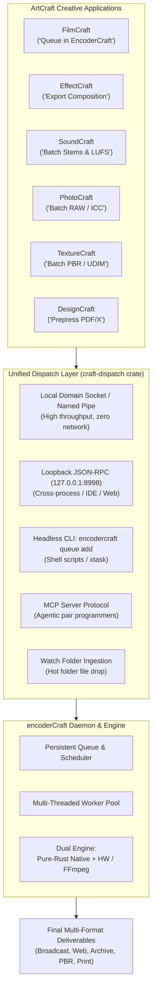

# Inter-App Dispatch Protocol Specification: "Send to EncoderCraft"

> **Protocol Version:** 1.0.0 (Draft)  
> **Target:** ArtCraft Application Ecosystem (`storytold/*`)  
> **Prepared for:** `encoderCraft` (`el-j/encodercraft` → `storytold/encodercraft`)  
> **Status:** Architecture & Implementation Specification  

---

## 1. Architectural Motivation

In professional workflows, media creation applications (NLEs, motion compositors, DAWs, photo editors, 3D suites) should not lock their user interface while rendering multi-gigabyte exports or complex multi-target delivery batches.

In the Adobe ecosystem, Adobe Premiere Pro, After Effects, and Audition delegate heavy encoding tasks to Adobe Media Encoder via dynamic background linking ("Queue in Media Encoder").

In the ArtCraft ecosystem, **`encoderCraft`** provides this centralized role. Any ArtCraft application—as well as third-party tools, shell scripts, and autonomous AI agents—can offload rendering, format conversion, and batch queuing to `encoderCraft`.



---

## 2. Dispatch Paradigms

To accommodate different media types, file sizes, and hardware constraints, the protocol defines **three dispatch modes**:

### Mode A: File Source Hand-off (Direct / Mezzanine)
- **Use Case:** The file already exists on disk (e.g., camera RAW photos, 3D meshes, audio recordings, video rushes), or the host app wrote a fast, uncompressed intermediate file (e.g., ProRes 4444 or 32-bit float WAV).
- **Mechanism:** The host app sends a job specification containing absolute paths to the source file(s) and the desired output presets.
- **Overhead:** Near-zero IPC overhead; disk I/O only.

### Mode B: Dynamic Zero-Copy Frame Streaming (Direct Pipe)
- **Use Case:** Heavy timelines (FilmCraft video sequences, EffectCraft motion graphics compositions) where writing hundreds of gigabytes of intermediate uncompressed frames to disk would be slow and wasteful.
- **Mechanism:**
  1. The host app opens a dedicated IPC connection (Unix Domain Socket, Windows Named Pipe, or shared memory ring buffer) to `encoderCraft`.
  2. The host app renders frames on-demand in its headless background worker and writes raw video frames (`-f rawvideo -pix_fmt rgba64le` or `yuv422p10le`) and planar audio chunks (`-f f32le`).
  3. `encoderCraft` consumes the stream directly into its encoder pipelines without touching disk storage.
- **Overhead:** Memory bandwidth only; instantaneous startup.

### Mode C: Headless Project Delegation (Deferred Rendering)
- **Use Case:** The user queues a complex project in `encoderCraft` and closes the host application completely (freeing GPU/RAM).
- **Mechanism:**
  1. The host app saves a clean snapshot of its project (`.filmcraft`, `.effectcraft`, `.photocraft`, `.texturecraft`).
  2. The job specification points to the project file path, the target sequence/composition ID, and the host app's CLI binary path.
  3. `encoderCraft` executes the host CLI in headless slave mode (e.g., `filmcraft-cli render --headless --sequence-id seq_01 --pipe`) and pipes the output into its encoding engine.

---

## 3. Data Specification: `CraftJobSpec`

All communication uses standard JSON (or Bincode for internal binary IPC). Every job submission conforms to the following schema:

```json
{
  "version": "1.0.0",
  "jobId": "job_01hgb78y9z0123456789abcdef",
  "clientInfo": {
    "appName": "FilmCraft",
    "appVersion": "0.9.4",
    "pid": 48291,
    "userNotes": "Client Approval Cut v3"
  },
  "priority": "Normal",
  "startPolicy": "AutoStart",
  "source": {
    "type": "File",
    "path": "/Volumes/FastMedia/Projects/Commercial_2026/Master_Edit.mov",
    "range": {
      "startTick": 0,
      "durationTicks": 4320000,
      "timebase": 120000
    },
    "metadata": {
      "title": "Spring Launch Commercial",
      "artist": "Studio ArtCraft",
      "timecodeStart": "01:00:00:00"
    }
  },
  "targets": [
    {
      "targetId": "tgt_youtube_4k",
      "outputPath": "/Volumes/FastMedia/Exports/Commercial_YouTube_4K.mp4",
      "presetName": "YouTube 2160p 4K UHD",
      "format": "H264",
      "container": "IsoBmffMp4",
      "video": {
        "width": 3840,
        "height": 2160,
        "frameRate": [60, 1],
        "bitrateMode": {
          "type": "Vbr1Pass",
          "targetKbps": 45000,
          "maxKbps": 60000
        },
        "colorSpace": "Rec709",
        "hardwareAcceleration": "Auto"
      },
      "audio": {
        "codec": "Aac",
        "sampleRate": 48000,
        "channels": 2,
        "bitrateKbps": 320,
        "loudnessNormalization": {
          "standard": "EbuR128",
          "targetLufs": -14.0,
          "maxTruePeakDbfs": -1.0
        }
      },
      "effects": {
        "watermark": null,
        "timecodeBurnIn": false,
        "lutPath": null
      }
    },
    {
      "targetId": "tgt_prores_archive",
      "outputPath": "/Volumes/FastMedia/Exports/Commercial_ProRes_Master.mov",
      "presetName": "Apple ProRes 422 HQ",
      "format": "ProRes",
      "container": "QuickTimeMov",
      "video": {
        "profile": "ProRes422Hq",
        "colorSpace": "Rec709"
      },
      "audio": {
        "codec": "PcmLinear",
        "sampleRate": 48000,
        "channels": 2,
        "bitDepth": 24
      }
    }
  ],
  "notifications": {
    "onCompleteWebhook": "http://127.0.0.1:48291/api/export-done",
    "systemNotification": true
  }
}
```

---

## 4. IPC & Transport Protocols

### 4.1 Transport Layers

| Platform | Primary Transport | Path / Address | Security / Isolation |
|---|---|---|---|
| **macOS & Linux** | Unix Domain Socket | `/tmp/encodercraft-$UID.sock` (or `$XDG_RUNTIME_DIR/encodercraft.sock`) | File system permissions `0600` (current user only). |
| **Windows** | Named Pipe | `\\.\pipe\encodercraft-%USERNAME%` | Access control list restricted to user SID. |
| **Local Network / Web** | Loopback TCP JSON-RPC | `127.0.0.1:8998` | Bearer token stored in `~/.config/encodercraft/token`. |
| **Shell & Automation** | Headless CLI command | `encodercraft queue add --spec <file>` | Subprocess exit codes and stdout JSON response. |
| **AI Coding Agents** | Model Context Protocol (MCP) | `stdio` or SSE | Strict tool schemas for agent inspection and submission. |

### 4.2 Lifecycle & Daemon Auto-Launch
When an ArtCraft application prepares to dispatch a job:
1. **Probe Connection:** The host app attempts to connect to the local socket `/tmp/encodercraft-$UID.sock`.
2. **Auto-Launch if Idle:** If connection fails (socket does not exist or refused):
   - The host app checks user preferences (`Launch EncoderCraft GUI` vs. `Spawn Headless Background Daemon`).
   - If GUI is preferred: launches `encodercraft --minimized`.
   - If headless daemon is preferred: spawns `encodercraft-cli daemon --fork`.
3. **Handshake:** Waits up to 3000 ms for socket initialization, then exchanges protocol version.
4. **Submit & Confirm:** Posts `queue.submit` request and receives `jobId`.

---

## 5. Bidirectional JSON-RPC API Methods

### 5.1 Client Requests (Host App → EncoderCraft)

#### `queue.submit`
Submits one or more jobs to the active queue.
- **Params:** `CraftJobSpec`
- **Returns:** `{ "jobId": "...", "status": "Queued", "queuePosition": 2 }`

#### `queue.pause` / `queue.resume`
Pauses or resumes encoding execution across the entire queue or for a specific job.
- **Params:** `{ "jobId": "..." }` (optional; if omitted, pauses the global queue)
- **Returns:** `{ "status": "Paused" }`

#### `queue.cancel`
Immediately aborts processing of a job, terminates active child renderers, and cleans up incomplete temporary files.
- **Params:** `{ "jobId": "...", "deletePartialFiles": true }`
- **Returns:** `{ "status": "Cancelled" }`

#### `queue.list`
Returns real-time status of all queued, active, completed, and failed jobs.
- **Returns:** Array of job statuses with progress, throughput, and estimated completion time.

#### `presets.list`
Returns the full hierarchy of available system, custom, and format presets so the host app can populate its export dialogs dynamically.
- **Returns:** Tree of preset categories, names, formats, and parameter schemas.

### 5.2 Server Notifications (EncoderCraft → Host App)

#### `job.progress`
Emitted at throttled intervals (default: 4 times per second per active job):
```json
{
  "jsonrpc": "2.0",
  "method": "job.progress",
  "params": {
    "jobId": "job_01hgb78y9z0123456789abcdef",
    "targetId": "tgt_youtube_4k",
    "progressFraction": 0.452,
    "currentFrame": 1952,
    "totalFrames": 4320,
    "encodingFps": 74.8,
    "elapsedSeconds": 26.1,
    "estimatedRemainingSeconds": 31.6,
    "pass": 1,
    "totalPasses": 1
  }
}
```

#### `job.completed`
Emitted when all targets of a job have finished successfully:
```json
{
  "jsonrpc": "2.0",
  "method": "job.completed",
  "params": {
    "jobId": "job_01hgb78y9z0123456789abcdef",
    "durationSeconds": 57.7,
    "results": [
      {
        "targetId": "tgt_youtube_4k",
        "outputPath": "/Volumes/FastMedia/Exports/Commercial_YouTube_4K.mp4",
        "fileSizeBytes": 328491024,
        "loudnessReport": {
          "integratedLufs": -14.02,
          "truePeakDbfs": -1.05,
          "loudnessRangeLu": 6.4
        }
      }
    ]
  }
}
```

#### `job.failed`
Emitted if encoding fails due to I/O error, invalid input, or resource exhaustion:
```json
{
  "jsonrpc": "2.0",
  "method": "job.failed",
  "params": {
    "jobId": "job_01hgb78y9z0123456789abcdef",
    "targetId": "tgt_prores_archive",
    "errorCategory": "DiskSpaceExhausted",
    "message": "Target volume has only 120 MB remaining; required 4.2 GB."
  }
}
```

---

## 6. Model Context Protocol (MCP) Agent Interface

For autonomous pair programming and robotic task pipelines, `encoderCraft` exposes an MCP server (`encodercraft-mcp`). This allows AI agents to inspect and control encoding without opening the graphical interface.

### Registered Tools
1. `encodercraft_submit_transcode(source_path, preset_name, output_path)`: Submits a single file transcode job.
2. `encodercraft_batch_convert(folder_path, glob_filter, target_preset, output_folder)`: Batch converts entire directories.
3. `encodercraft_get_queue_status()`: Returns the queue items, active progress, and failures.
4. `encodercraft_list_presets(category_filter)`: Lists available presets.
5. `encodercraft_inspect_media(file_path)`: Analyzes media streams, codecs, bitrates, audio channels, and color tags.

---

## 7. The Shared Client Crate: `craft-dispatch`

To make adoption effortless across all ArtCraft applications, a shared Rust crate named `craft-dispatch` will be placed in `craft-libs/crates/dispatch`.

Any app needs only two lines of code to dispatch a job:
```rust
use craft_dispatch::{Client, CraftJobSpec};

let client = Client::connect_default()?;
let job_id = client.submit_job(&my_job_spec)?;
```

If `encoderCraft` is installed, the job appears instantly in the queue. If not installed, `craft-dispatch` gracefully returns `DispatchError::EncoderCraftNotInstalled`, allowing the host app to offer a download prompt or fall back to its internal synchronous export.
