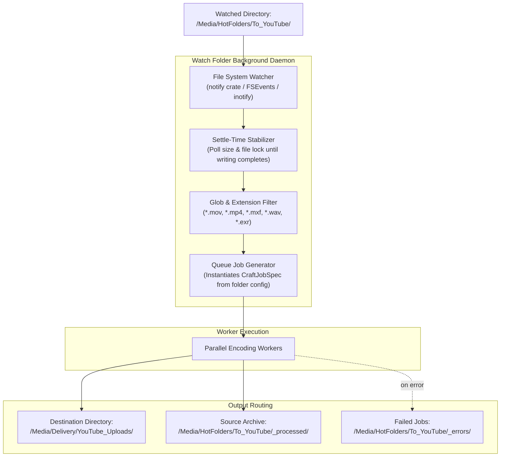

# Preset Engine & Watch Folder Automation Specification

> **Target:** `encoderCraft` (`el-j/encodercraft` → `storytold/encodercraft`)  
> **Prepared for:** ArtCraft Ecosystem Architecture  
> **Status:** Specification Document  

---

## 1. The Universal Preset System

A core feature of Adobe Media Encoder is its extensive preset browser and customizable encoding presets. In `encoderCraft`, presets are elevated from simple video bitrate settings into **universal multi-media export recipes**.

A preset in `encoderCraft` encapsulates the entire configuration required to transform raw input into a delivery asset, including scaling, color management, bit depth quantization, audio normalization, channel mapping, metadata tagging, and container multiplexing.

### 1.1 Category Hierarchy

Presets are organized into an intuitive tree hierarchy with strict categorization:

```
Presets Browser
├── 📁 System / Factory Presets (Read-Only)
│   ├── 📁 Match Source
│   │   ├── ⚡ Match Source – Adaptive High Bitrate (Default)
│   │   ├── ⚡ Match Source – Adaptive Medium Bitrate
│   │   └── ⚡ Match Source – Lossless Intermediate (ProRes 422 HQ)
│   ├── 📁 Web & Social Media
│   │   ├── 🌐 YouTube (2160p 4K, 1440p 2K, 1080p Full HD, Shorts 1080x1920)
│   │   ├── 🌐 TikTok / Instagram Reels (1080x1920, 30fps, AAC 192k)
│   │   ├── 🌐 Vimeo (High Quality Multi-Rate)
│   │   ├── 🌐 Twitter / X (1080p, 60fps, 25 Mbps cap)
│   │   └── 🌐 Web Optimization (WebM VP9, Animated WebP, AVIF)
│   ├── 📁 Broadcast & Master Archival
│   │   ├── 📺 Apple ProRes (ProRes 4444 XQ, 4444 with Alpha, 422 HQ, 422, Proxy)
│   │   ├── 📺 Avid DNxHR / DNxHD (HQX 10-bit, SQ 8-bit, LB 8-bit)
│   │   ├── 📺 MXF OP-1a Broadcast Master (EBU R128 -23 LUFS, 50 Mbps CBR)
│   │   └── 📺 APV Master (Next-generation intra archival)
│   ├── 📁 Audio & Music Mastering
│   │   ├── 🎵 Master Delivery (Broadcast WAV / BWF, 96 kHz, 24-bit)
│   │   ├── 🎵 Streaming Music (FLAC Lossless, -14 LUFS, True Peak -1.0 dBTP)
│   │   ├── 🎵 Podcast Delivery (MP3 128k / AAC 160k, -16 LUFS Integrated)
│   │   └── 🎵 Multi-Channel Stems (Split 5.1 / 7.1 to discrete mono tracks)
│   ├── 📁 Photography, Textures & Prepress
│   │   ├── 🖼️ Web Images (Responsive WebP + AVIF + JPEG srcset)
│   │   ├── 🖼️ VFX & Compositing (OpenEXR Multi-Layer 16-bit Half, Cryptomatte)
│   │   ├── 🖼️ Game Engine Textures (Packed BC7 DDS + ORM Channels + UDIM)
│   │   └── 🖼️ Commercial Prepress (PDF/X-4 CMYK with 3mm Bleed & Crop Marks)
│   └── 📁 3D & Spatial Assets
│       ├── 🧊 Web 3D (Optimized glTF 2.0 / GLB with Draco Compression)
│       ├── 🧊 Apple AR Quick Look (USDZ with PBR Textures)
│       └── 🧊 3D Printing (Binary STL, millimeter unit calibration)
└── 📁 User Presets (Editable, Persistent JSON in User Data)
    ├── 📁 My Project Defaults
    └── 📁 Custom Delivery Specs
```

---

## 2. Dynamic "Match Source" Logic

The most frequently used preset in modern video workflows is "Match Source". Instead of forcing the user to know the frame rate, resolution, aspect ratio, or channel count of their footage, `encoderCraft` dynamically interrogates the source media at encode time:

```
┌─────────────────────────────────┐
│ Input Media Analysis (Demuxer)  │
│ Width: 3840, Height: 2160       │
│ FPS: 23.976, Pixel Aspect: 1.0  │
│ Audio: 48 kHz, 6 Channels (5.1) │
│ Color: Rec.709, 10-bit          │
└───────────────┬─────────────────┘
                │
                ▼
┌─────────────────────────────────┐
│ Dynamic Preset Evaluation       │
│ Resolution: None → 3840x2160    │
│ Rate: None → 23.976 fps         │
│ Audio Channels: None → 6 ch     │
│ Target Bitrate: Calculated via  │
│ Area × FPS × BPP Formula        │
└───────────────┬─────────────────┘
                │
                ▼
┌─────────────────────────────────┐
│ Configured Transcode Pipeline   │
│ Encodes with exact dimensions,  │
│ zero resampling distortion      │
└─────────────────────────────────┘
```

### Adaptive Bitrate Calculation Formula
When "Adaptive High Bitrate" is selected, the encoder calculates the target kilobits per second ($R$) dynamically:
$$R = \text{clamp}\left( W \times H \times F \times C \times 10^{-3},\; R_{\min},\; R_{\max} \right)$$
Where:
- $W, H$ are frame width and height.
- $F$ is frame rate in frames per second.
- $C$ is the bits-per-pixel motion factor ($0.12$ for high quality, $0.07$ for medium).
- For 4K UHD at 24fps: $3840 \times 2160 \times 24 \times 0.12 \times 10^{-3} \approx 23,887\text{ kbps}$ (capped at 45,000 kbps).

---

## 3. Preset Data Schema (`ExportPreset`)

All presets are serialized as clean JSON (or TOML). Factory presets are embedded in the binary via `include_str!`, while user presets are stored in `$APP_DATA/encodercraft/presets/*.json`.

```rust
#[derive(Clone, Debug, Serialize, Deserialize)]
#[serde(rename_all = "camelCase")]
pub struct ExportPreset {
    pub id: String,
    pub name: String,
    pub category: String,
    pub description: String,
    pub format: MediaFormat,
    pub container: ContainerType,
    #[serde(default)]
    pub video: Option<VideoSettings>,
    #[serde(default)]
    pub audio: Option<AudioSettings>,
    #[serde(default)]
    pub effects: Option<EffectsSettings>,
    #[serde(default)]
    pub spatial: Option<Spatial3DSettings>,
    #[serde(default)]
    pub document: Option<DocumentSettings>,
    #[serde(default)]
    pub metadata: Option<MetadataSettings>,
    #[serde(skip)]
    pub is_builtin: bool,
}
```

### Detailed Component Settings

#### Video Settings (`VideoSettings`)
- `width`: `Option<u32>` (`None` = Match Source).
- `height`: `Option<u32>` (`None` = Match Source).
- `frame_rate`: `Option<FrameRate>` (`None` = Match Source).
- `aspect_ratio`: `PixelAspectRatio` (Square 1.0, D1/DV NTSC 0.9091, Anamorphic 2:1, etc.).
- `field_order`: `FieldOrder` (Progressive, Upper First, Lower First).
- `bitrate_mode`: `BitrateMode` (CBR, VBR 1-Pass, VBR 2-Pass, Constant Quality CQ/CRF).
- `target_kbps`: `u32`.
- `max_kbps`: `Option<u32>`.
- `quality_crf`: `Option<u8>` (0 to 63, e.g. CRF 18 for visually lossless).
- `gop_length`: `Option<u32>` (Keyframe interval).
- `color_space`: `ColorSpaceTag` (Rec709, DisplayP3, Rec2020PQ, Rec2020HLG, sRGB).
- `hardware_acceleration`: `HardwarePolicy` (Auto, ForceHardware, ForceNativeSoftware).

#### Audio Settings (`AudioSettings`)
- `codec`: `AudioCodec` (Aac, PcmLinear, Flac, Opus, Mp3, Alac).
- `sample_rate`: `Option<u32>` (44100, 48000, 96000, `None` = Match Source).
- `channels`: `Option<u32>` (1 = Mono, 2 = Stereo, 6 = 5.1, `None` = Match Source).
- `bit_depth`: `u8` (16, 24, 32).
- `bitrate_kbps`: `u32` (e.g. 320 for high-fidelity AAC).
- `loudness_normalization`: `Option<LoudnessNormalization>`:
  - `standard`: `LoudnessStandard` (EbuR128, ItuBs1770_4, Netflix, Spotify, YouTube).
  - `target_lufs`: `f32` (e.g. `-14.0` for web, `-23.0` for EBU, `-24.0` for ATSC).
  - `max_true_peak_dbfs`: `f32` (e.g. `-1.0`).

#### Effects & Filters (`EffectsSettings`)
- `watermark`: `Option<WatermarkConfig>` (file path, scale, opacity, corner position, offset).
- `timecode_burnin`: `bool` (burn SMPTE timecode onto lower third).
- `lut_path`: `Option<PathBuf>` (3D `.cube` or `.3dl` color lookup table).
- `captions`: `CaptionOption` (BurnIn, SidecarSrt, SidecarVtt, Drop).

---

## 4. Watch Folder Automation Engine

Watch Folders allow enterprise ingest and automated pipeline conversion: any file dropped into a monitored folder is automatically picked up, processed through one or more presets, and written to a target directory.



### 4.1 Stability & Settle-Time Protocol
A frequent bug in legacy watch folder systems is attempting to encode a file while it is still being copied over the network or written by a camera offload tool.

`encoderCraft` implements a **three-stage settle-delay protocol**:
1. **Change Ingestion:** When a `Create` or `Modify` event arrives from the OS notification system, the file is placed in a `PendingStabilization` set with a timestamp.
2. **Size Quiescence Check:** Every 1,000 ms, the daemon queries `std::fs::metadata(path).len()`. The file must maintain the exact same byte count for a configurable quiet window (default: 3 seconds).
3. **Exclusive Lock Probe:** The daemon attempts to open the file with exclusive read/write access. If the operating system reports the file is locked by another process (e.g. Finder copy, browser download, FTP server), the settle timer resets.
4. Only when both quiescence and exclusive access succeed does the file transition to the active encoding queue.

### 4.2 Template Token Replacement
Destination file names and folder structures are generated using template tokens:
- `{source_name}`: Base file name without extension.
- `{source_ext}`: Original extension.
- `{preset}`: Name of the export preset applied.
- `{format}`: Output container/codec format.
- `{resolution}`: e.g. `3840x2160` or `1080p`.
- `{date}`: ISO 8601 date stamp (`YYYY-MM-DD`).
- `{time}`: Timestamp (`HH-MM-SS`).
- `{uuid}`: Unique 8-character job hash.

Example template:
`{date}/{preset}/{source_name}_{resolution}.{format}`  
Yields:  
`2026-11-01/YouTube_4K/Commercial_Cut_3840x2160.mp4`

### 4.3 Post-Processing Actions
For every watched folder, the user can configure what happens to the source file once encoding succeeds:
- **`DoNothing`**: Leave the source file where it is (a hidden `.encodercraft-history` database prevents re-encoding).
- **`MoveToProcessed`**: Automatically moves source files into a `_processed/` subfolder.
- **`DeleteSource`**: Deletes the source file (useful for temporary intermediate render drops).
- **`MoveToErrors`**: If encoding fails, moves the source file to `_errors/` and writes a detailed diagnostic text log (`{source_name}.error.log`).
